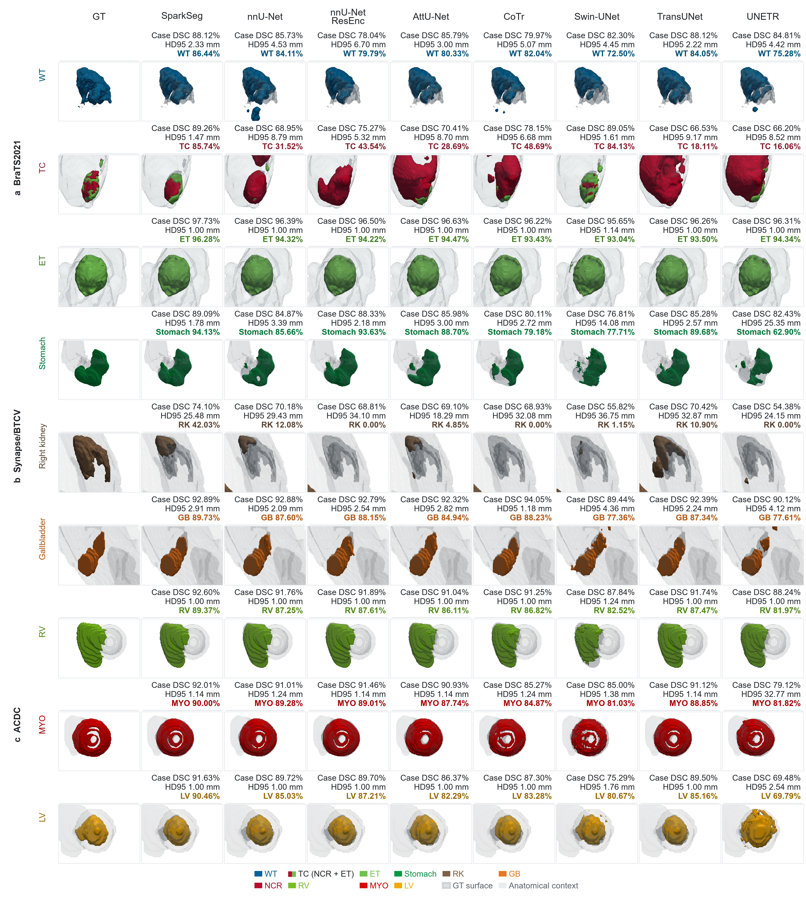
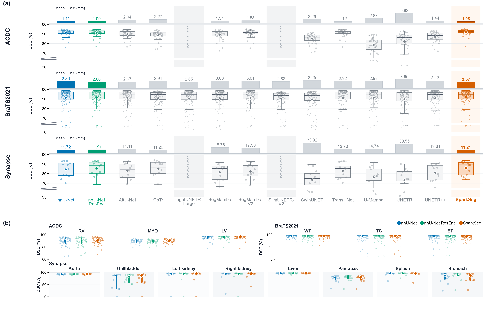
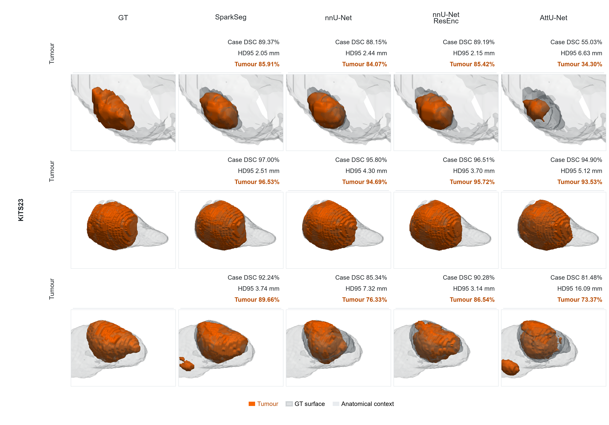
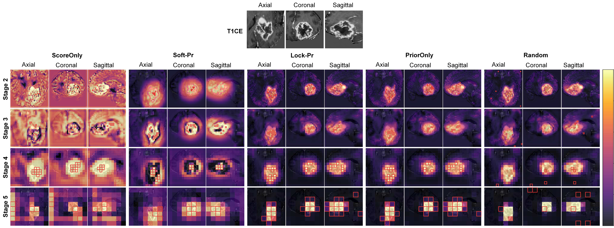
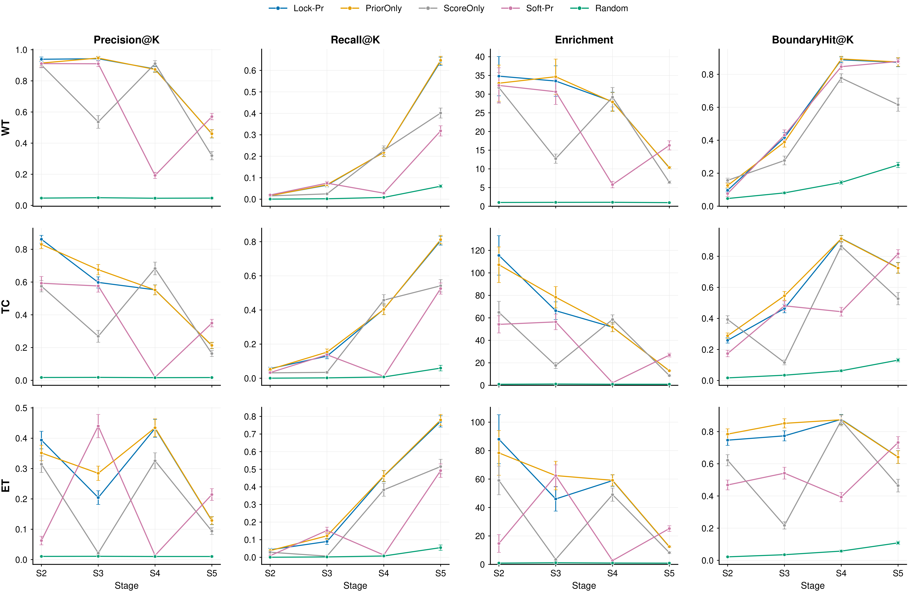

# ✨ SparkSeg

English | [Chinese](README_CN.md)

**Sparse prior-guided anchor attention for budgeted 3D CT and MRI segmentation**


## 🧩 Method

SparkSeg retains a dense convolutional U-Net feature grid and allocates a fixed context budget to task-relevant anchors.

| Stage | Operation |
|---|---|
| Stage 1 | Zero-initialised tri-axial enhancement (TAE) |
| Stages 2–5 | TAE, prior-gated token selection (PGTS), hard Top-K, multi-source sparse block attention (MSBA), gated write-back, and parallel WinMHSA3D |
| Stage 6 | CNN bottleneck with an auxiliary prior head |
| Decoder | U-Net decoder with one attention gate per level |

The anchor budgets at Stages 2–5 are `128/64/32/32`. The training objective is
`L_seg + 0.05 L_prior + 0.02 L_prioraux`. Optimisation uses SGD with an initial
learning rate of `1e-2`, Nesterov momentum `0.99`, weight decay `3e-5`, and
polynomial decay, with `250/50` training/validation iterations per epoch.

## 📊 Results

DSC is reported in % and HD95 in mm. Best values are shown in red bold.

| Dataset | Modality | SparkSeg DSC | Matched control | Control DSC | Δ DSC | SparkSeg HD95 | Control HD95 | p |
|---|---|---:|---|---:|---:|---:|---:|---:|
| ACDC | MRI | <strong><span style="color:#d62728">91.98</span></strong> | nnU-Net ResEnc | 91.13 | +0.85 | <strong><span style="color:#d62728">1.08</span></strong> | 1.09 | 2.7e-5 |
| BraTS2021 | MRI | <strong><span style="color:#d62728">91.73</span></strong> | nnU-Net plain | 91.36 | +0.36 | <strong><span style="color:#d62728">2.57</span></strong> | 2.86 | 1.00 |
| Synapse/BTCV | CT | <strong><span style="color:#d62728">85.94</span></strong> | nnU-Net ResEnc | 85.54 | +0.40 | <strong><span style="color:#d62728">11.21</span></strong> | 11.91 | 0.76 |
| KiTS23 | CT | <strong><span style="color:#d62728">85.66</span></strong> | nnU-Net ResEnc | 84.36 | +1.30 | <strong><span style="color:#d62728">13.41</span></strong> | 17.78 | - |

Matched controls use the same encoder architecture as SparkSeg: ACDC, Synapse,
and KiTS23 use nnU-Net ResEnc, while BraTS2021 uses plain nnU-Net. The KiTS23
comparison also includes plain nnU-Net at 85.12 DSC / 18.41 mm.

## 📋 Full method comparison

The following tables report all methods. The best value in each DSC/HD95
column is shown in red bold.

### Table 1. BraTS2021 comparison

BraTS2021: DSC (%) and HD95 (mm).

<table>
<thead><tr>
<th>Model</th>
<th>DSC WT</th>
<th>DSC TC</th>
<th>DSC ET</th>
<th>DSC Avg</th>
<th>HD95 WT</th>
<th>HD95 TC</th>
<th>HD95 ET</th>
<th>HD95 Avg</th>
<th>Memory T/I (GB)</th>
<th>Params (M)</th>
<th>FLOPs (G)</th>
<th>Latency (s)</th>
</tr></thead>
<tbody>
<tr>
<td>nnU-Net [1]</td>
<td>93.96</td>
<td>91.91</td>
<td>88.22</td>
<td>91.36</td>
<td>3.68</td>
<td>2.83</td>
<td>2.06</td>
<td>2.86</td>
<td>~6.2 / 1.7</td>
<td>~31.2</td>
<td>~538.1</td>
<td>~0.340</td>
</tr>
<tr>
<td>nnU-Net ResEnc [22]</td>
<td><strong><span style="color:#d62728">94.05</span></strong></td>
<td>91.92</td>
<td>88.57</td>
<td>91.51</td>
<td>3.33</td>
<td>2.54</td>
<td>1.93</td>
<td>2.60</td>
<td>~11.6 / 2.2</td>
<td>~102.4</td>
<td>~778.3</td>
<td>~0.460</td>
</tr>
<tr>
<td>AttU-Net [9]</td>
<td>94.02</td>
<td>91.59</td>
<td>88.20</td>
<td>91.27</td>
<td>3.29</td>
<td>2.54</td>
<td>2.17</td>
<td>2.67</td>
<td>~13.6 / 2.4</td>
<td>~23.6</td>
<td>~586</td>
<td>~0.311</td>
</tr>
<tr>
<td>CoTr [24]</td>
<td>93.78</td>
<td>91.13</td>
<td>87.99</td>
<td>90.97</td>
<td>3.59</td>
<td>2.97</td>
<td>2.17</td>
<td>2.91</td>
<td>~12.0 / 3.2</td>
<td>~41.9</td>
<td>~787.4</td>
<td>~0.301</td>
</tr>
<tr>
<td>LightUNETR-Large [36]</td>
<td>93.46</td>
<td>90.55</td>
<td>87.08</td>
<td>90.36</td>
<td><strong><span style="color:#d62728">3.22</span></strong></td>
<td>2.69</td>
<td>2.05</td>
<td>2.65</td>
<td>~15.7 / 3.8</td>
<td>~3.9</td>
<td>~129.4</td>
<td>~0.544</td>
</tr>
<tr>
<td>SegMamba [16]</td>
<td>94.04</td>
<td>91.35</td>
<td>87.57</td>
<td>90.99</td>
<td>3.73</td>
<td>3.08</td>
<td>2.20</td>
<td>3.00</td>
<td>~37.2 / 6.9</td>
<td>~67.4</td>
<td>~1573</td>
<td>~0.728</td>
</tr>
<tr>
<td>SegMamba-V2 [17]</td>
<td>93.89</td>
<td>91.44</td>
<td>88.30</td>
<td>91.21</td>
<td>3.80</td>
<td>2.73</td>
<td>2.49</td>
<td>3.01</td>
<td>~18.0 / 3.0</td>
<td>~139.2</td>
<td>~1982.5</td>
<td>~0.595</td>
</tr>
<tr>
<td>SlimUNETR-V2 [37]</td>
<td>92.93</td>
<td>91.74</td>
<td>86.20</td>
<td>90.29</td>
<td>3.49</td>
<td>2.54</td>
<td>2.43</td>
<td>2.82</td>
<td>~15.9 / 0.3</td>
<td>~23.6</td>
<td>~41.9</td>
<td>~0.138</td>
</tr>
<tr>
<td>Swin-Unet [7]</td>
<td>92.97</td>
<td>89.85</td>
<td>85.80</td>
<td>89.54</td>
<td>4.25</td>
<td>3.14</td>
<td>2.37</td>
<td>3.25</td>
<td>~9.2 / 3.1</td>
<td>~30.6</td>
<td>~46.8</td>
<td>~0.251</td>
</tr>
<tr>
<td>TransUNet [4]</td>
<td>93.58</td>
<td>91.36</td>
<td>88.50</td>
<td>91.15</td>
<td>3.94</td>
<td>2.82</td>
<td>1.99</td>
<td>2.92</td>
<td>~13.4 / 4.8</td>
<td>~119.0</td>
<td>~555</td>
<td>~0.620</td>
</tr>
<tr>
<td>U-Mamba [13]</td>
<td>93.78</td>
<td>91.74</td>
<td>88.58</td>
<td>91.37</td>
<td>3.78</td>
<td>2.78</td>
<td>2.22</td>
<td>2.93</td>
<td>~18.8 / 3.4</td>
<td>~42.2</td>
<td>~975.5</td>
<td>~0.384</td>
</tr>
<tr>
<td>UNETR [5]</td>
<td>92.97</td>
<td>90.18</td>
<td>86.67</td>
<td>89.94</td>
<td>4.18</td>
<td>3.85</td>
<td>2.96</td>
<td>3.66</td>
<td>~8.2 / 2.9</td>
<td>~130.8</td>
<td>~202.8</td>
<td>~0.288</td>
</tr>
<tr>
<td>UNETR++ [38]</td>
<td>93.54</td>
<td>91.69</td>
<td>87.59</td>
<td>90.94</td>
<td>3.93</td>
<td>3.06</td>
<td>2.40</td>
<td>3.13</td>
<td>~6.5 / 1.2</td>
<td>~23.5</td>
<td>~87.5</td>
<td>~0.265</td>
</tr>
<tr>
<td>SparkSeg</td>
<td>93.87</td>
<td><strong><span style="color:#d62728">92.68</span></strong></td>
<td><strong><span style="color:#d62728">88.63</span></strong></td>
<td><strong><span style="color:#d62728">91.73</span></strong></td>
<td>3.41</td>
<td><strong><span style="color:#d62728">2.41</span></strong></td>
<td><strong><span style="color:#d62728">1.89</span></strong></td>
<td><strong><span style="color:#d62728">2.57</span></strong></td>
<td>~11.3 / 2.5</td>
<td>~34.8</td>
<td>~575.1</td>
<td>~0.356</td>
</tr>
</tbody>
</table>

### Table 2. ACDC comparison

ACDC: DSC (%) and HD95 (mm).

<table>
<thead><tr>
<th>Model</th>
<th>DSC RV</th>
<th>DSC MYO</th>
<th>DSC LV</th>
<th>DSC Avg</th>
<th>HD95 RV</th>
<th>HD95 MYO</th>
<th>HD95 LV</th>
<th>HD95 Avg</th>
<th>Memory T/I (GB)</th>
<th>Params (M)</th>
<th>FLOPs (G)</th>
<th>Latency (s)</th>
</tr></thead>
<tbody>
<tr>
<td>nnU-Net [1]</td>
<td>88.66</td>
<td>89.51</td>
<td>95.33</td>
<td>91.17</td>
<td>1.25</td>
<td><strong><span style="color:#d62728">1.02</span></strong></td>
<td>1.06</td>
<td>1.11</td>
<td>~6.2 / 0.6</td>
<td>~31.2</td>
<td>~203.4</td>
<td>~0.075</td>
</tr>
<tr>
<td>nnU-Net ResEnc [22]</td>
<td>88.70</td>
<td>89.27</td>
<td>95.41</td>
<td>91.13</td>
<td>1.22</td>
<td><strong><span style="color:#d62728">1.02</span></strong></td>
<td>1.03</td>
<td>1.09</td>
<td>~14.5 / 1.2</td>
<td>~102.4</td>
<td>~374.3</td>
<td>~0.055</td>
</tr>
<tr>
<td>AttU-Net [9]</td>
<td>86.60</td>
<td>88.15</td>
<td>94.72</td>
<td>89.83</td>
<td>4.04</td>
<td>1.04</td>
<td>1.04</td>
<td>2.04</td>
<td>~13.0 / 0.7</td>
<td>~23.6</td>
<td>~176.9</td>
<td>~0.045</td>
</tr>
<tr>
<td>CoTr [24]</td>
<td>85.24</td>
<td>86.68</td>
<td>94.07</td>
<td>88.66</td>
<td>4.64</td>
<td>1.09</td>
<td>1.09</td>
<td>2.27</td>
<td>~16.8 / 1.9</td>
<td>~41.9</td>
<td>~310.7</td>
<td>~0.112</td>
</tr>
<tr>
<td>SegMamba [16]</td>
<td>85.79</td>
<td>87.95</td>
<td>94.39</td>
<td>89.37</td>
<td>1.73</td>
<td>1.14</td>
<td>1.07</td>
<td>1.31</td>
<td>~45.5 / 3.1</td>
<td>~67.4</td>
<td>~678.8</td>
<td>~0.117</td>
</tr>
<tr>
<td>SegMamba-V2 [17]</td>
<td>87.94</td>
<td>89.10</td>
<td>95.22</td>
<td>90.76</td>
<td>2.58</td>
<td>1.13</td>
<td>1.04</td>
<td>1.58</td>
<td>~26.2 / 1.7</td>
<td>~139.2</td>
<td>~863.6</td>
<td>~0.100</td>
</tr>
<tr>
<td>Swin-Unet [7]</td>
<td>80.61</td>
<td>82.63</td>
<td>92.31</td>
<td>85.18</td>
<td>4.38</td>
<td>1.31</td>
<td>1.19</td>
<td>2.29</td>
<td>~25.5 / 2.3</td>
<td>~30.6</td>
<td>~40.4</td>
<td>~0.212</td>
</tr>
<tr>
<td>TransUNet [4]</td>
<td>88.73</td>
<td>89.07</td>
<td>95.24</td>
<td>91.01</td>
<td>1.29</td>
<td>1.03</td>
<td><strong><span style="color:#d62728">1.02</span></strong></td>
<td>1.12</td>
<td>~18.1 / 2.6</td>
<td>~119.0</td>
<td>~232.4</td>
<td>~0.161</td>
</tr>
<tr>
<td>U-Mamba [13]</td>
<td>71.23</td>
<td>75.30</td>
<td>89.09</td>
<td>78.54</td>
<td>4.64</td>
<td>2.07</td>
<td>1.89</td>
<td>2.87</td>
<td>~18.4 / 3.4</td>
<td>~42.2</td>
<td>~359.3</td>
<td>~0.092</td>
</tr>
<tr>
<td>UNETR [5]</td>
<td>74.98</td>
<td>80.84</td>
<td>90.84</td>
<td>82.22</td>
<td>14.31</td>
<td>1.62</td>
<td>1.55</td>
<td>5.83</td>
<td>~10.5 / 1.4</td>
<td>~130.8</td>
<td>~85.4</td>
<td>~0.095</td>
</tr>
<tr>
<td>UNETR++ [38]</td>
<td>82.23</td>
<td>85.39</td>
<td>93.06</td>
<td>86.89</td>
<td>1.90</td>
<td>1.29</td>
<td>1.14</td>
<td>1.44</td>
<td>~12.8 / 1.5</td>
<td>~23.5</td>
<td>~64.1</td>
<td>~0.120</td>
</tr>
<tr>
<td>SparkSeg</td>
<td><strong><span style="color:#d62728">90.24</span></strong></td>
<td><strong><span style="color:#d62728">89.90</span></strong></td>
<td><strong><span style="color:#d62728">95.80</span></strong></td>
<td><strong><span style="color:#d62728">91.98</span></strong></td>
<td><strong><span style="color:#d62728">1.19</span></strong></td>
<td><strong><span style="color:#d62728">1.02</span></strong></td>
<td><strong><span style="color:#d62728">1.02</span></strong></td>
<td><strong><span style="color:#d62728">1.08</span></strong></td>
<td>~15.0 / 1.2</td>
<td>~111.1</td>
<td>~440.4</td>
<td>~0.087</td>
</tr>
</tbody>
</table>

### Table 3a. Synapse/BTCV DSC

Synapse/BTCV: DSC (%) by organ.

<table>
<thead><tr>
<th>Model</th>
<th>Aor.</th>
<th>Gal.</th>
<th>LKid.</th>
<th>RKid.</th>
<th>Liv.</th>
<th>Pan.</th>
<th>Spl.</th>
<th>Sto.</th>
<th>Avg DSC</th>
</tr></thead>
<tbody>
<tr>
<td>nnU-Net [1]</td>
<td>92.70</td>
<td>66.09</td>
<td>87.07</td>
<td>87.17</td>
<td>96.54</td>
<td>74.30</td>
<td>92.86</td>
<td>78.70</td>
<td>84.43</td>
</tr>
<tr>
<td>nnU-Net ResEnc [22]</td>
<td>93.16</td>
<td>70.77</td>
<td>85.60</td>
<td>86.45</td>
<td>96.48</td>
<td>75.83</td>
<td>93.69</td>
<td><strong><span style="color:#d62728">82.31</span></strong></td>
<td>85.54</td>
</tr>
<tr>
<td>AttU-Net [9]</td>
<td>92.91</td>
<td>68.55</td>
<td>83.68</td>
<td>84.97</td>
<td>96.36</td>
<td>69.72</td>
<td>91.95</td>
<td>76.55</td>
<td>83.09</td>
</tr>
<tr>
<td>CoTr [24]</td>
<td><strong><span style="color:#d62728">93.48</span></strong></td>
<td>67.06</td>
<td>86.84</td>
<td>86.30</td>
<td>96.82</td>
<td><strong><span style="color:#d62728">78.68</span></strong></td>
<td>92.97</td>
<td>80.64</td>
<td>85.35</td>
</tr>
<tr>
<td>SegMamba [16]</td>
<td>91.03</td>
<td>61.18</td>
<td>85.43</td>
<td>86.99</td>
<td>95.83</td>
<td>68.26</td>
<td>91.47</td>
<td>73.24</td>
<td>81.68</td>
</tr>
<tr>
<td>SegMamba-V2 [17]</td>
<td>92.50</td>
<td>59.65</td>
<td><strong><span style="color:#d62728">87.71</span></strong></td>
<td>85.23</td>
<td>95.92</td>
<td>70.15</td>
<td><strong><span style="color:#d62728">94.83</span></strong></td>
<td>73.90</td>
<td>82.49</td>
</tr>
<tr>
<td>Swin-Unet [7]</td>
<td>83.30</td>
<td>54.93</td>
<td>79.20</td>
<td>74.86</td>
<td>92.85</td>
<td>49.66</td>
<td>85.29</td>
<td>68.21</td>
<td>73.54</td>
</tr>
<tr>
<td>TransUNet [4]</td>
<td>93.18</td>
<td>64.04</td>
<td>85.65</td>
<td>87.03</td>
<td>96.57</td>
<td>70.69</td>
<td>91.25</td>
<td>75.81</td>
<td>83.03</td>
</tr>
<tr>
<td>U-Mamba [13]</td>
<td>91.64</td>
<td>58.98</td>
<td>80.94</td>
<td>77.30</td>
<td>96.03</td>
<td>60.08</td>
<td>87.66</td>
<td>58.20</td>
<td>76.35</td>
</tr>
<tr>
<td>UNETR [5]</td>
<td>84.49</td>
<td>63.26</td>
<td>78.44</td>
<td>78.01</td>
<td>93.79</td>
<td>51.34</td>
<td>80.49</td>
<td>56.40</td>
<td>73.28</td>
</tr>
<tr>
<td>UNETR++ [38]</td>
<td>91.78</td>
<td>58.16</td>
<td>86.61</td>
<td>85.45</td>
<td>95.84</td>
<td>64.81</td>
<td>91.19</td>
<td>74.73</td>
<td>81.07</td>
</tr>
<tr>
<td>SparkSeg</td>
<td>93.25</td>
<td><strong><span style="color:#d62728">73.66</span></strong></td>
<td>85.54</td>
<td><strong><span style="color:#d62728">89.93</span></strong></td>
<td><strong><span style="color:#d62728">96.97</span></strong></td>
<td>75.20</td>
<td>92.49</td>
<td>80.45</td>
<td><strong><span style="color:#d62728">85.94</span></strong></td>
</tr>
</tbody>
</table>

### Table 3b. Synapse/BTCV HD95 and resources

Synapse/BTCV: HD95 (mm) and resources.

<table>
<thead><tr>
<th>Model</th>
<th>Aor.</th>
<th>Gal.</th>
<th>LKid.</th>
<th>RKid.</th>
<th>Liv.</th>
<th>Pan.</th>
<th>Spl.</th>
<th>Sto.</th>
<th>Avg HD95</th>
<th>Memory T/I (GB)</th>
<th>Params (M)</th>
<th>FLOPs (G)</th>
<th>Latency (s)</th>
</tr></thead>
<tbody>
<tr>
<td>nnU-Net [1]</td>
<td>3.12</td>
<td>25.26</td>
<td>17.50</td>
<td>7.26</td>
<td>4.29</td>
<td>10.02</td>
<td>8.14</td>
<td>20.04</td>
<td>11.72</td>
<td>~7.9 / 3.1</td>
<td>~31.2</td>
<td>~619.6</td>
<td>~3.290</td>
</tr>
<tr>
<td>nnU-Net ResEnc [22]</td>
<td><strong><span style="color:#d62728">1.48</span></strong></td>
<td>14.60</td>
<td>18.34</td>
<td>8.94</td>
<td>7.41</td>
<td>7.09</td>
<td>21.13</td>
<td><strong><span style="color:#d62728">17.34</span></strong></td>
<td>11.91</td>
<td>~11.7 / 3.5</td>
<td>~102.4</td>
<td>~916.2</td>
<td>~5.785</td>
</tr>
<tr>
<td>AttU-Net [9]</td>
<td>4.83</td>
<td>23.22</td>
<td>7.91</td>
<td>24.00</td>
<td>3.19</td>
<td>10.44</td>
<td>8.13</td>
<td>32.88</td>
<td>14.11</td>
<td>~15.0 / 2.6</td>
<td>~23.6</td>
<td>~670.4</td>
<td>~4.079</td>
</tr>
<tr>
<td>CoTr [24]</td>
<td>1.49</td>
<td>18.45</td>
<td>15.91</td>
<td>10.15</td>
<td>2.16</td>
<td><strong><span style="color:#d62728">6.40</span></strong></td>
<td>6.95</td>
<td>31.51</td>
<td>11.29</td>
<td>~14.5 / 3.6</td>
<td>~41.9</td>
<td>~865.6</td>
<td>~3.818</td>
</tr>
<tr>
<td>SegMamba [16]</td>
<td>8.74</td>
<td>31.36</td>
<td>17.85</td>
<td>6.16</td>
<td>15.80</td>
<td>9.56</td>
<td>29.31</td>
<td>33.66</td>
<td>18.76</td>
<td>~42.3 / 8.7</td>
<td>~67.4</td>
<td>~2037.2</td>
<td>~12.166</td>
</tr>
<tr>
<td>SegMamba-V2 [17]</td>
<td>8.09</td>
<td>22.52</td>
<td>15.29</td>
<td>22.53</td>
<td>18.16</td>
<td>16.04</td>
<td><strong><span style="color:#d62728">6.60</span></strong></td>
<td>32.42</td>
<td>17.50</td>
<td>~23.0 / 3.4</td>
<td>~139.2</td>
<td>~2591.6</td>
<td>~10.181</td>
</tr>
<tr>
<td>Swin-Unet [7]</td>
<td>34.78</td>
<td>23.13</td>
<td>53.22</td>
<td>28.03</td>
<td>17.86</td>
<td>16.43</td>
<td>62.78</td>
<td>36.69</td>
<td>33.92</td>
<td>~13.6 / 4.8</td>
<td>~30.6</td>
<td>~62.0</td>
<td>~5.292</td>
</tr>
<tr>
<td>TransUNet [4]</td>
<td>1.87</td>
<td>25.85</td>
<td>18.73</td>
<td>8.88</td>
<td><strong><span style="color:#d62728">1.76</span></strong></td>
<td>11.04</td>
<td>13.30</td>
<td>30.17</td>
<td>13.70</td>
<td>~16.8 / 6.9</td>
<td>~119.0</td>
<td>~663.8</td>
<td>~9.667</td>
</tr>
<tr>
<td>U-Mamba [13]</td>
<td>11.34</td>
<td>23.03</td>
<td><strong><span style="color:#d62728">4.96</span></strong></td>
<td>10.81</td>
<td>4.76</td>
<td>28.66</td>
<td>11.50</td>
<td>24.55</td>
<td>14.74</td>
<td>~24.1 / 4.7</td>
<td>~42.2</td>
<td>~1126.8</td>
<td>~7.493</td>
</tr>
<tr>
<td>UNETR [5]</td>
<td>10.91</td>
<td>18.71</td>
<td>26.95</td>
<td>46.51</td>
<td>42.48</td>
<td>23.24</td>
<td>38.98</td>
<td>37.76</td>
<td>30.55</td>
<td>~13.0 / 4.2</td>
<td>~130.8</td>
<td>~256.4</td>
<td>~5.476</td>
</tr>
<tr>
<td>UNETR++ [38]</td>
<td>2.43</td>
<td>18.04</td>
<td>17.31</td>
<td>24.51</td>
<td>3.50</td>
<td>11.42</td>
<td>8.97</td>
<td>23.78</td>
<td>13.61</td>
<td>~7.8 / 3.2</td>
<td>~23.5</td>
<td>~64.5</td>
<td>~9.335</td>
</tr>
<tr>
<td>SparkSeg</td>
<td>1.67</td>
<td><strong><span style="color:#d62728">13.23</span></strong></td>
<td>18.60</td>
<td><strong><span style="color:#d62728">3.87</span></strong></td>
<td>2.12</td>
<td>9.66</td>
<td>21.57</td>
<td>19.86</td>
<td><strong><span style="color:#d62728">11.21</span></strong></td>
<td>~13.7 / 2.7</td>
<td>~111.1</td>
<td>~1089.4</td>
<td>~7.523</td>
</tr>
</tbody>
</table>

### Table 4. KiTS23 comparison

KiTS23: DSC (%) and HD95 (mm).

<table>
<thead><tr>
<th>Model</th>
<th>DSC K&amp;M</th>
<th>DSC KM</th>
<th>DSC T</th>
<th>DSC Avg</th>
<th>HD95 K&amp;M</th>
<th>HD95 KM</th>
<th>HD95 T</th>
<th>HD95 Avg</th>
</tr></thead>
<tbody>
<tr>
<td>nnU-Net</td>
<td>95.89</td>
<td>81.56</td>
<td>77.92</td>
<td>85.12</td>
<td>11.02</td>
<td>20.49</td>
<td>23.73</td>
<td>18.41</td>
</tr>
<tr>
<td>nnU-Net ResEnc</td>
<td>95.69</td>
<td>81.32</td>
<td>76.06</td>
<td>84.36</td>
<td>8.60</td>
<td>19.69</td>
<td>25.06</td>
<td>17.78</td>
</tr>
<tr>
<td>AttU-Net</td>
<td>94.47</td>
<td>77.76</td>
<td>72.35</td>
<td>81.53</td>
<td>13.13</td>
<td>26.90</td>
<td>31.83</td>
<td>23.95</td>
</tr>
<tr>
<td>SparkSeg</td>
<td><strong><span style="color:#d62728">96.16</span></strong></td>
<td><strong><span style="color:#d62728">82.83</span></strong></td>
<td><strong><span style="color:#d62728">78.00</span></strong></td>
<td><strong><span style="color:#d62728">85.66</span></strong></td>
<td><strong><span style="color:#d62728">5.86</span></strong></td>
<td><strong><span style="color:#d62728">15.18</span></strong></td>
<td><strong><span style="color:#d62728">19.19</span></strong></td>
<td><strong><span style="color:#d62728">13.41</span></strong></td>
</tr>
</tbody>
</table>

## 🧠 Available trainers

| Modality | Dataset | ID | Trainer | Host | Initialisation | Epochs |
|---|---|---:|---|---|---|---:|
| MRI | ACDC | 100 | `nnUNetTrainerSparkSegACDC` | residual encoder | no `stock_he` | 200 |
| MRI | BraTS2021 | 1251 | `nnUNetTrainerSparkSegBraTS2021` | plain U-Net | no `stock_he` | 1,000 |
| CT | Synapse/BTCV | 180 | `nnUNetTrainerSparkSegSynapse` | residual encoder | `stock_he` | 1,000 |
| CT | KiTS23 | 489 | `nnUNetTrainerSparkSegKiTS23` | residual encoder | `stock_he` | 1,000 |

Trainer implementations are in [nnUNetTrainerSparkSeg.py](nnUNetTrainerSparkSeg.py),
and the evaluator is in [nnUNetTrainerSparkSeg_eval.py](nnUNetTrainerSparkSeg_eval.py).
Model, configuration, and utility code are organised under [network](network/).

| Dataset | Patch | Batch | Training memory | Params | FLOPs | Latency |
|---|---|---:|---:|---:|---:|---:|
| ACDC | 224×256×10 | 7 | 15.0 GB | 111.1 M | 440.4 G | 0.087 s |
| BraTS2021 | 128×128×128 | 2 | 11.3 GB | 34.8 M | 575.1 G | 0.356 s |
| Synapse/BTCV | 56×192×224 | 2 | 13.7 GB | 111.1 M | 1,089.4 G | 7.523 s |
| KiTS23 | 128×128×128 | 2 | — | — | — | — |

## ⚙️ Installation

The commands below use a Linux or WSL shell. The three data directories are
configured by the user; the scripts read the standard nnU-Net environment
variables:

```text
nnUNet_raw           raw data
nnUNet_preprocessed  preprocessed data
nnUNet_results       training results and checkpoints
```

```bash
cd /path/to/SparkSeg
python -m pip install -e .

export NNUNET_DATA_ROOT=/path/to/nnUNet_data
export nnUNet_raw="$NNUNET_DATA_ROOT/nnUNet_raw"
export nnUNet_preprocessed="$NNUNET_DATA_ROOT/nnUNet_preprocessed"
export nnUNet_results="$NNUNET_DATA_ROOT/nnUNet_results"

python -m SparkSeg.reproduce doctor --datasets acdc brats synapse kits23
```

SparkSeg depends on the standard `nnunetv2` package. For training and prediction,
the reproduction CLI creates temporary trainer registration files, so no external
evaluation or bridge scripts are required.

## 🚀 Training

Prepare a new dataset first. For KiTS23:

```bash
python -m SparkSeg.reproduce prepare --datasets kits23
```

Prepare all four datasets with:

```bash
python -m SparkSeg.reproduce prepare --datasets acdc brats synapse kits23
```

Train each dataset with:

```bash
python -m SparkSeg.reproduce train --datasets acdc
python -m SparkSeg.reproduce train --datasets brats
python -m SparkSeg.reproduce train --datasets synapse
python -m SparkSeg.reproduce train --datasets kits23
```

For multi-GPU training:

```bash
python -m SparkSeg.reproduce train --datasets brats --num-gpus 2
```

The trained checkpoint is written to:

```text
$nnUNet_results/<Dataset>/<Trainer>__nnUNetPlans__3d_fullres/fold_<fold>/checkpoint_final.pth
```

## 🔎 Prediction and evaluation

```bash
python -m SparkSeg.reproduce predict --datasets acdc
python -m SparkSeg.reproduce predict --datasets brats
python -m SparkSeg.reproduce predict --datasets synapse
python -m SparkSeg.reproduce predict --datasets kits23

python -m SparkSeg.reproduce evaluate --datasets acdc
python -m SparkSeg.reproduce evaluate --datasets brats
python -m SparkSeg.reproduce evaluate --datasets synapse
python -m SparkSeg.reproduce evaluate --datasets kits23
```

`validate` is an alias of `evaluate`. Predictions and metrics are written under:

```text
$nnUNet_raw/<Dataset>/labelsTs_SparkSeg/final_pre
```

Inference uses no test-time augmentation (TTA).

| Dataset | Metric files |
|---|---|
| ACDC | `metrics_ACDC_testset.json/.csv` |
| BraTS2021 | `metrics_BraTS_WT_TC_ET_testset.json/.csv` |
| Synapse/BTCV | `metrics_synapse_testset.json/.csv` |
| KiTS23 | `metrics_KiTS23_HEC_testset.json/.csv` |

## 📦 Release weights

The current tag is `v1.3.0`. `bundle` writes the weight archives to:

```text
./SparkSeg_releases/v1.3.0
```

Upload the following five files to the GitHub Release:

```text
sparkseg-acdc-mri-3d_fullres.zip
sparkseg-brats2021-mri-3d_fullres.zip
sparkseg-synapse-ct-3d_fullres.zip
sparkseg-kits23-ct-3d_fullres.zip
SHA256SUMS.txt
```

The same list is stored in [RELEASE_FILES.txt](RELEASE_FILES.txt).

To download and install the released weights:

```bash
python -m SparkSeg.reproduce download --out ./SparkSeg_releases --tag v1.3.0

python -m SparkSeg.reproduce install \
  ./SparkSeg_releases/sparkseg-acdc-mri-3d_fullres.zip \
  ./SparkSeg_releases/sparkseg-brats2021-mri-3d_fullres.zip \
  ./SparkSeg_releases/sparkseg-synapse-ct-3d_fullres.zip \
  ./SparkSeg_releases/sparkseg-kits23-ct-3d_fullres.zip

python -m SparkSeg.reproduce verify --load-checkpoints
```

Each archive contains `manifest.json`, `plans.json`, `dataset.json`, and
`fold_<fold>/checkpoint_final.pth`, with `splits_final.json` when a fixed split
is used.

Rebuild the release archives with:

```bash
python -m SparkSeg.reproduce bundle \
  --out ./SparkSeg_releases/v1.3.0
```

## 🐍 Python API

```python
from SparkSeg import build_sparkseg, describe_preset

strides = [[1, 1, 1], [2, 2, 2], [2, 2, 2], [2, 2, 2], [2, 2, 2], [2, 2, 2]]
net = build_sparkseg(4, 4, plan_strides=strides, preset="brats")
print(describe_preset("brats"))
```

Preset names are `acdc`, `brats`/`brats2021`, `synapse`/`btcv`, and
`kits23`/`kits`. Dataset IDs and nnU-Net folder names are also accepted.

## 🗂️ Data and splits

Fixed split files are provided in [splits](splits/).

| Dataset | Modality | Cases | Training / validation / held-out test | Source |
|---|---|---:|---|---|
| ACDC | MRI | 100 patients | 70 / 10 / 20 patients (140 / 20 / 40 volumes) | [Human Heart Project](https://humanheart-project.creatis.insa-lyon.fr/database/#collection/637218c173e9f0047faa00fb) |
| BraTS2021 | MRI | 1,251 | 875 / 125 / 251 | [Synapse syn25829067](https://www.synapse.org/Synapse:syn25829067) |
| Synapse/BTCV | CT | 30 | 18 training; 12 held-out test | [Synapse syn3193805](https://www.synapse.org/Synapse:syn3193805/wiki/89480) |
| KiTS23 | CT | 489 | 342 / 49 / 98 | [KiTS23 challenge](https://kits-challenge.org/kits23/) |

Preprocessing, plans, topology, and augmentation follow the standard `3d_fullres`
protocol. KiTS23 is distributed under CC BY-NC-SA 4.0.

## 🖼️ Figures

<p align="center">
  <a href="assets/paper/fig01_overview_pr.png"></a>
</p>

<table>
  <tr>
    <td align="center"><a href="assets/paper/fig02_qualitative_pr.png"></a><br><strong>Figure 2</strong>: Qualitative comparison</td>
    <td align="center"><a href="assets/paper/fig03_per_case_dsc_pr.png"></a><br><strong>Figure 3</strong>: Per-case DSC and mean HD95</td>
  </tr>
  <tr>
    <td align="center"><a href="assets/paper/fig04_resource_profiles_pr.png"></a><br><strong>Figure 4</strong>: Memory, FLOPs, and latency</td>
    <td align="center"><a href="assets/paper/fig05_kits23_pr.png"></a><br><strong>Figure 5</strong>: KiTS23 tumour comparison</td>
  </tr>
  <tr>
    <td align="center"><a href="assets/paper/fig06_anchor_visualisation_pr.png"></a><br><strong>Figure 6</strong>: Top-K anchors at Stages 2–5</td>
    <td align="center"><a href="assets/paper/fig07_selection_quality_pr.png"></a><br><strong>Figure 7</strong>: Anchor selection quality</td>
  </tr>
</table>

## 📄 Citation and licence

```bibtex
@misc{chai2026sparkseg,
  author  = {Chai, Shuaishuai and Jin, Liang and Li, Ming},
  title   = {SparkSeg: Sparse Prior-Guided Anchor Attention for Budgeted 3D CT and MRI Segmentation},
  year    = {2026},
  url     = {https://github.com/sshuaichai/SparkSeg}
}
```

Released under [Apache-2.0](LICENSE.txt). Training and inference use
[nnU-Net](https://github.com/MIC-DKFZ/nnUNet).
