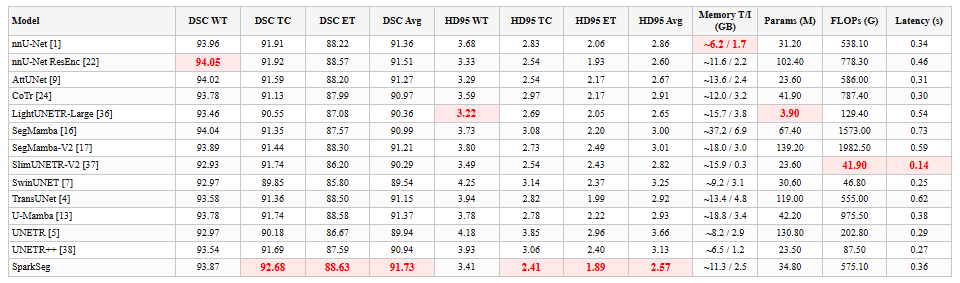
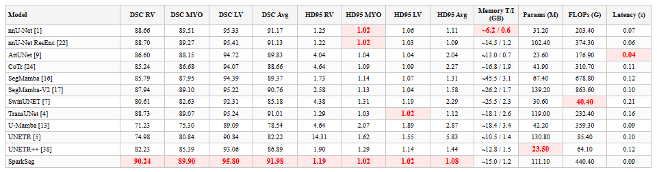
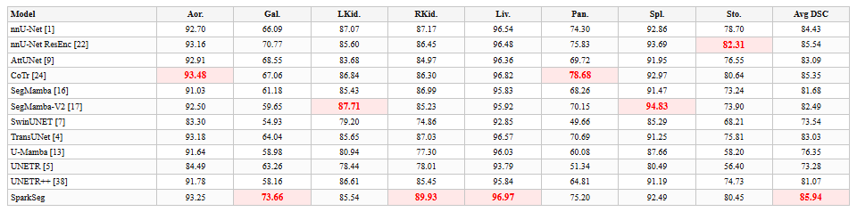
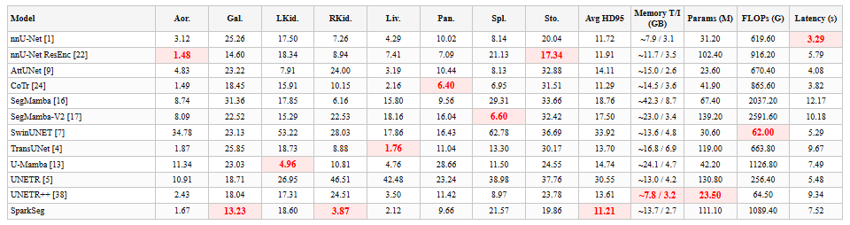
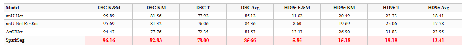

# ✨ SparkSeg

English | [Chinese](README_CN.md)

**Sparse prior-guided anchor attention for budgeted 3D CT and MRI segmentation**


## 💡 Highlights

- **Task-aware sparse context.** SparkSeg keeps the dense convolutional U-Net
  host and replaces unbounded token interaction with a fixed contextual budget
  focused on task-relevant anatomy.
- **Prior-guided hard Top-K anchors.** PGTS combines anatomical priors with
  learnable scores and selects anchors under the stage budgets `128/64/32/32`.
- **Multi-source sparse read and write.** MSBA aggregates selected anchors,
  current features, and previous-stage evidence; gated write-back updates only
  the chosen locations and preserves the dense feature path.
- **Complementary multi-scale modelling.** Parallel WinMHSA3D adds window
  context, while zero-initialised TAE, attention-gated decoding, and auxiliary
  prior supervision preserve detail and guide anchor selection.

Training uses `L_seg + 0.05 L_prior + 0.02 L_prioraux`, SGD with learning rate
`1e-2`, Nesterov momentum `0.99`, weight decay `3e-5`, polynomial decay, and
`250/50` training/validation iterations per epoch.

## 📊 Results

DSC is reported in % and HD95 in mm. Higher DSC and lower HD95 are better. The
best value in every numerical column is red bold with a pale red cell; memory is
ranked by training/inference memory, and lower parameters, FLOPs, and latency
are preferred.

| Dataset | Modality | SparkSeg DSC | Matched control | Control DSC | Δ DSC | SparkSeg HD95 | Control HD95 | p |
|---|---|---:|---|---:|---:|---:|---:|---:|
| ACDC | MRI | <strong><span style="color:#d62728">91.98</span></strong> | nnU-Net ResEnc | 91.13 | +0.85 | <strong><span style="color:#d62728">1.08</span></strong> | 1.09 | 2.7e-5 |
| BraTS2021 | MRI | <strong><span style="color:#d62728">91.73</span></strong> | nnU-Net plain | 91.36 | +0.36 | <strong><span style="color:#d62728">2.57</span></strong> | 2.86 | 1.00 |
| Synapse/BTCV | CT | <strong><span style="color:#d62728">85.94</span></strong> | nnU-Net ResEnc | 85.54 | +0.40 | <strong><span style="color:#d62728">11.21</span></strong> | 11.91 | 0.76 |
| KiTS23 | CT | <strong><span style="color:#d62728">85.66</span></strong> | nnU-Net ResEnc | 84.36 | +1.30 | <strong><span style="color:#d62728">13.41</span></strong> | 17.78 | - |

Matched controls use the same encoder architecture as SparkSeg: ACDC, Synapse,
and KiTS23 use nnU-Net ResEnc, while BraTS2021 uses plain nnU-Net. The KiTS23
comparison also includes plain nnU-Net at 85.12 DSC / 18.41 mm.

## 📋 Full method comparison

The following tables report all methods. The best value in each DSC/HD95
column is shown in red bold.

### Table 1. BraTS2021 comparison

BraTS2021: DSC (%) and HD95 (mm).

<p align="center">
  <a href="assets/paper/table1_brats2021_v5.png"></a>
</p>

### Table 2. ACDC comparison

ACDC: DSC (%) and HD95 (mm).

<p align="center">
  <a href="assets/paper/table2_acdc_v5.png"></a>
</p>

### Table 3a. Synapse/BTCV DSC

Synapse/BTCV: DSC (%) by organ.

<p align="center">
  <a href="assets/paper/table3a_synapse_dsc_v5.png"></a>
</p>

### Table 3b. Synapse/BTCV HD95 and resources

Synapse/BTCV: HD95 (mm) and resources.

<p align="center">
  <a href="assets/paper/table3b_synapse_hd95_resources_v5.png"></a>
</p>

### Table 4. KiTS23 comparison

KiTS23: DSC (%) and HD95 (mm).

<p align="center">
  <a href="assets/paper/table4_kits23_v5.png"></a>
</p>

## 🧠 Available trainers

| Modality | Dataset | ID | Trainer | Host | Initialisation | Epochs |
|---|---|---:|---|---|---|---:|
| MRI | ACDC | 100 | `nnUNetTrainerSparkSegACDC` | residual encoder | no `stock_he` | 200 |
| MRI | BraTS2021 | 1251 | `nnUNetTrainerSparkSegBraTS2021` | plain U-Net | no `stock_he` | 1,000 |
| CT | Synapse/BTCV | 180 | `nnUNetTrainerSparkSegSynapse` | residual encoder | `stock_he` | 1,000 |
| CT | KiTS23 | 489 | `nnUNetTrainerSparkSegKiTS23` | residual encoder | `stock_he` | 1,000 |

Trainer implementations are in [nnUNetTrainerSparkSeg.py](nnUNetTrainerSparkSeg.py),
and the evaluator is in [nnUNetTrainerSparkSeg_eval.py](nnUNetTrainerSparkSeg_eval.py).
Model, configuration, and utility code are organised under [network](network/).

| Dataset | Patch | Batch | Training memory | Params | FLOPs | Latency |
|---|---|---:|---:|---:|---:|---:|
| ACDC | 224×256×10 | 7 | 15.0 GB | 111.1 M | 440.4 G | 0.087 s |
| BraTS2021 | 128×128×128 | 2 | 11.3 GB | 34.8 M | 575.1 G | 0.356 s |
| Synapse/BTCV | 56×192×224 | 2 | 13.7 GB | 111.1 M | 1,089.4 G | 7.523 s |
| KiTS23 | 128×128×128 | 2 | — | — | — | — |

## ⚙️ Installation

The commands below use a Linux or WSL shell. The three data directories are
configured by the user; the scripts read the standard nnU-Net environment
variables:

```text
nnUNet_raw           raw data
nnUNet_preprocessed  preprocessed data
nnUNet_results       training results and checkpoints
```

```bash
cd /path/to/SparkSeg
python -m pip install -e .

export NNUNET_DATA_ROOT=/path/to/nnUNet_data
export nnUNet_raw="$NNUNET_DATA_ROOT/nnUNet_raw"
export nnUNet_preprocessed="$NNUNET_DATA_ROOT/nnUNet_preprocessed"
export nnUNet_results="$NNUNET_DATA_ROOT/nnUNet_results"

python -m SparkSeg.reproduce doctor --datasets acdc brats synapse kits23
```

SparkSeg depends on the standard `nnunetv2` package. For training and prediction,
the reproduction CLI creates temporary trainer registration files, so no external
evaluation or bridge scripts are required.

## 🚀 Training

Prepare a new dataset first. For KiTS23:

```bash
python -m SparkSeg.reproduce prepare --datasets kits23
```

Prepare all four datasets with:

```bash
python -m SparkSeg.reproduce prepare --datasets acdc brats synapse kits23
```

Train each dataset with:

```bash
python -m SparkSeg.reproduce train --datasets acdc
python -m SparkSeg.reproduce train --datasets brats
python -m SparkSeg.reproduce train --datasets synapse
python -m SparkSeg.reproduce train --datasets kits23
```

For multi-GPU training:

```bash
python -m SparkSeg.reproduce train --datasets brats --num-gpus 2
```

The trained checkpoint is written to:

```text
$nnUNet_results/<Dataset>/<Trainer>__nnUNetPlans__3d_fullres/fold_<fold>/checkpoint_final.pth
```

## 🔎 Prediction and evaluation

```bash
python -m SparkSeg.reproduce predict --datasets acdc
python -m SparkSeg.reproduce predict --datasets brats
python -m SparkSeg.reproduce predict --datasets synapse
python -m SparkSeg.reproduce predict --datasets kits23

python -m SparkSeg.reproduce evaluate --datasets acdc
python -m SparkSeg.reproduce evaluate --datasets brats
python -m SparkSeg.reproduce evaluate --datasets synapse
python -m SparkSeg.reproduce evaluate --datasets kits23
```

`validate` is an alias of `evaluate`. Predictions and metrics are written under:

```text
$nnUNet_raw/<Dataset>/labelsTs_SparkSeg/final_pre
```

Inference uses no test-time augmentation (TTA).

| Dataset | Metric files |
|---|---|
| ACDC | `metrics_ACDC_testset.json/.csv` |
| BraTS2021 | `metrics_BraTS_WT_TC_ET_testset.json/.csv` |
| Synapse/BTCV | `metrics_synapse_testset.json/.csv` |
| KiTS23 | `metrics_KiTS23_HEC_testset.json/.csv` |

## 📦 Release weights

The current tag is `v1.3.0`. `bundle` writes the weight archives to:

```text
./SparkSeg_releases/v1.3.0
```

Upload the following five files to the GitHub Release:

```text
sparkseg-acdc-mri-3d_fullres.zip
sparkseg-brats2021-mri-3d_fullres.zip
sparkseg-synapse-ct-3d_fullres.zip
sparkseg-kits23-ct-3d_fullres.zip
SHA256SUMS.txt
```

The same list is stored in [RELEASE_FILES.txt](RELEASE_FILES.txt).

To download and install the released weights:

```bash
python -m SparkSeg.reproduce download --out ./SparkSeg_releases --tag v1.3.0

python -m SparkSeg.reproduce install \
  ./SparkSeg_releases/sparkseg-acdc-mri-3d_fullres.zip \
  ./SparkSeg_releases/sparkseg-brats2021-mri-3d_fullres.zip \
  ./SparkSeg_releases/sparkseg-synapse-ct-3d_fullres.zip \
  ./SparkSeg_releases/sparkseg-kits23-ct-3d_fullres.zip

python -m SparkSeg.reproduce verify --load-checkpoints
```

Each archive contains `manifest.json`, `plans.json`, `dataset.json`, and
`fold_<fold>/checkpoint_final.pth`, with `splits_final.json` when a fixed split
is used.

Rebuild the release archives with:

```bash
python -m SparkSeg.reproduce bundle \
  --out ./SparkSeg_releases/v1.3.0
```

## 🐍 Python API

```python
from SparkSeg import build_sparkseg, describe_preset

strides = [[1, 1, 1], [2, 2, 2], [2, 2, 2], [2, 2, 2], [2, 2, 2], [2, 2, 2]]
net = build_sparkseg(4, 4, plan_strides=strides, preset="brats")
print(describe_preset("brats"))
```

Preset names are `acdc`, `brats`/`brats2021`, `synapse`/`btcv`, and
`kits23`/`kits`. Dataset IDs and nnU-Net folder names are also accepted.

## 🗂️ Data and splits

A fixed split file is provided in [splits](splits/) for every preset. ACDC,
BraTS2021, and KiTS23 train on fold 0. Synapse uses fold `all`: its split file
records the 18 cases in `imagesTr`, which nnU-Net uses for both training and
validation, while the 12 cases in `imagesTs` remain the held-out test set.

| Dataset | Modality | Cases | Training / validation / held-out test | Source |
|---|---|---:|---|---|
| ACDC | MRI | 100 patients | 70 / 10 / 20 patients (140 / 20 / 40 volumes) | [Human Heart Project](https://humanheart-project.creatis.insa-lyon.fr/database/#collection/637218c173e9f0047faa00fb) |
| BraTS2021 | MRI | 1,251 | 875 / 125 / 251 | [Synapse syn25829067](https://www.synapse.org/Synapse:syn25829067) |
| Synapse/BTCV | CT | 30 | 18 training; 12 held-out test | [Synapse syn3193805](https://www.synapse.org/Synapse:syn3193805/wiki/89480) |
| KiTS23 | CT | 489 | 342 / 49 / 98 | [KiTS23 challenge](https://kits-challenge.org/kits23/) |

Preprocessing, plans, topology, and augmentation follow the standard `3d_fullres`
protocol. KiTS23 is distributed under CC BY-NC-SA 4.0.

## 🖼️ Figures

<p align="center">
  <a href="assets/paper/fig01_overview_pr.png"></a>
</p>

<table>
  <tr>
    <td align="center"><a href="assets/paper/fig02_qualitative_pr.png"></a><br><strong>Figure 2</strong>: Qualitative comparison</td>
    <td align="center"><a href="assets/paper/fig03_per_case_dsc_pr.png"></a><br><strong>Figure 3</strong>: Per-case DSC and mean HD95</td>
  </tr>
  <tr>
    <td align="center"><a href="assets/paper/fig04_resource_profiles_pr.png"></a><br><strong>Figure 4</strong>: Memory, FLOPs, and latency</td>
    <td align="center"><a href="assets/paper/fig05_kits23_pr.png"></a><br><strong>Figure 5</strong>: KiTS23 tumour comparison</td>
  </tr>
  <tr>
    <td align="center"><a href="assets/paper/fig06_anchor_visualisation_pr.png"></a><br><strong>Figure 6</strong>: Top-K anchors at Stages 2–5</td>
    <td align="center"><a href="assets/paper/fig07_selection_quality_pr.png"></a><br><strong>Figure 7</strong>: Anchor selection quality</td>
  </tr>
</table>

## 📄 Citation and licence

```bibtex
@misc{chai2026sparkseg,
  author  = {Chai, Shuaishuai and Jin, Liang and Li, Ming},
  title   = {SparkSeg: Sparse Prior-Guided Anchor Attention for Budgeted 3D CT and MRI Segmentation},
  year    = {2026},
  url     = {https://github.com/sshuaichai/SparkSeg}
}
```

Released under [Apache-2.0](LICENSE.txt). Training and inference use
[nnU-Net](https://github.com/MIC-DKFZ/nnUNet).
