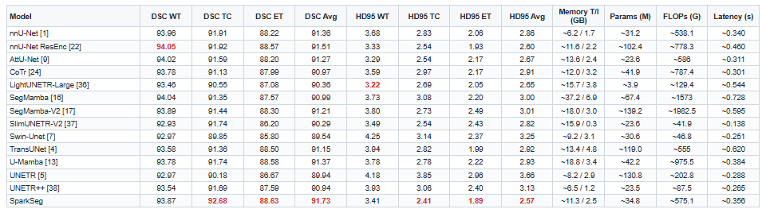
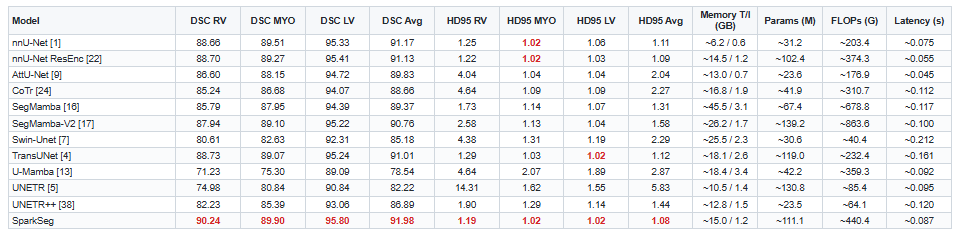
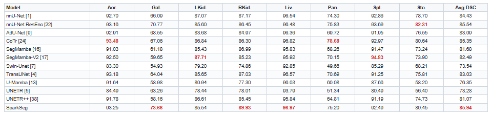
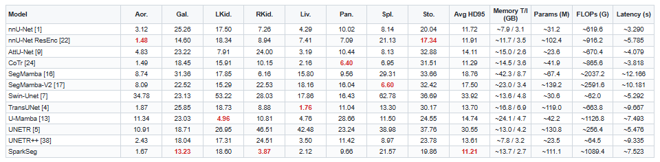
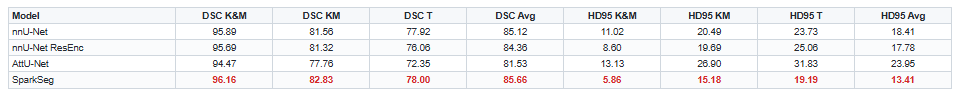

# ✨ SparkSeg

[English](README.md) | 中文

**面向预算化 3D CT / MRI 分割的稀疏先验引导锚点注意力网络**


## 🧩 方法

SparkSeg 保留稠密卷积 U-Net 特征网格，并把固定的上下文预算分配到任务相关锚点。

| 阶段 | 操作 |
|---|---|
| Stage 1 | 零初始化三轴增强 TAE |
| Stages 2–5 | TAE、先验门控 token 选择 PGTS、硬 Top-K、多源稀疏块注意力 MSBA、门控写回、并行 WinMHSA3D |
| Stage 6 | CNN 瓶颈层与辅助先验头 |
| Decoder | 每级一个注意力门的 U-Net 解码器 |

Stages 2–5 的锚点预算为 `128/64/32/32`。训练目标为
`L_seg + 0.05 L_prior + 0.02 L_prioraux`。优化器为 SGD，初始学习率
`1e-2`、Nesterov 动量 `0.99`、权重衰减 `3e-5`、多项式衰减，每个 epoch
执行 `250/50` 次训练/验证迭代。

## 📊 论文结果

DSC 单位为 %，HD95 单位为 mm。最优值用红色粗体显示。

| 数据集 | 模态 | SparkSeg DSC | 匹配对照 | 对照 DSC | Δ DSC | SparkSeg HD95 | 对照 HD95 | p |
|---|---|---:|---|---:|---:|---:|---:|---:|
| ACDC | MRI | <strong><span style="color:#d62728">91.98</span></strong> | nnU-Net ResEnc | 91.13 | +0.85 | <strong><span style="color:#d62728">1.08</span></strong> | 1.09 | 2.7e-5 |
| BraTS2021 | MRI | <strong><span style="color:#d62728">91.73</span></strong> | nnU-Net plain | 91.36 | +0.36 | <strong><span style="color:#d62728">2.57</span></strong> | 2.86 | 1.00 |
| Synapse/BTCV | CT | <strong><span style="color:#d62728">85.94</span></strong> | nnU-Net ResEnc | 85.54 | +0.40 | <strong><span style="color:#d62728">11.21</span></strong> | 11.91 | 0.76 |
| KiTS23 | CT | <strong><span style="color:#d62728">85.66</span></strong> | nnU-Net ResEnc | 84.36 | +1.30 | <strong><span style="color:#d62728">13.41</span></strong> | 17.78 | - |

匹配对照采用与 SparkSeg 相同的 encoder 架构：ACDC、Synapse 和 KiTS23 使用
nnU-Net ResEnc，BraTS2021 使用 plain nnU-Net。KiTS23 的稿件同时报告 plain
nnU-Net：85.12 DSC / 18.41 mm。

## 📋 论文全部方法对比

以下为稿件全部方法对比；每个 DSC/HD95 列的最优值以红色粗体显示。

### Table 1. BraTS2021 comparison

BraTS2021: DSC (%) and HD95 (mm).

<p align="center">
  <a href="assets/paper/table1_brats2021.png"></a>
</p>

### Table 2. ACDC comparison

ACDC: DSC (%) and HD95 (mm).

<p align="center">
  <a href="assets/paper/table2_acdc.png"></a>
</p>

### Table 3a. Synapse/BTCV DSC

Synapse/BTCV: DSC (%) by organ.

<p align="center">
  <a href="assets/paper/table3a_synapse_dsc.png"></a>
</p>

### Table 3b. Synapse/BTCV HD95 and resources

Synapse/BTCV: HD95 (mm) and resources.

<p align="center">
  <a href="assets/paper/table3b_synapse_hd95_resources.png"></a>
</p>

### Table 4. KiTS23 comparison

KiTS23: DSC (%) and HD95 (mm).

<p align="center">
  <a href="assets/paper/table4_kits23.png"></a>
</p>

## 🧠 可用训练器

| 模态 | 数据集 | ID | Trainer | 主干 | 初始化 | Epochs |
|---|---|---:|---|---|---|---:|
| MRI | ACDC | 100 | `nnUNetTrainerSparkSegACDC` | residual encoder | 不使用 `stock_he` | 200 |
| MRI | BraTS2021 | 1251 | `nnUNetTrainerSparkSegBraTS2021` | plain U-Net | 不使用 `stock_he` | 1,000 |
| CT | Synapse/BTCV | 180 | `nnUNetTrainerSparkSegSynapse` | residual encoder | `stock_he` | 1,000 |
| CT | KiTS23 | 489 | `nnUNetTrainerSparkSegKiTS23` | residual encoder | `stock_he` | 1,000 |

Trainer 实现位于 [nnUNetTrainerSparkSeg.py](nnUNetTrainerSparkSeg.py)，评估实现位于
[nnUNetTrainerSparkSeg_eval.py](nnUNetTrainerSparkSeg_eval.py)。模型、配置和
工具代码全部位于 [network](network/)。

| 数据集 | Patch | Batch | 训练显存 | Params | FLOPs | Latency |
|---|---|---:|---:|---:|---:|---:|
| ACDC | 224×256×10 | 7 | 15.0 GB | 111.1 M | 440.4 G | 0.087 s |
| BraTS2021 | 128×128×128 | 2 | 11.3 GB | 34.8 M | 575.1 G | 0.356 s |
| Synapse/BTCV | 56×192×224 | 2 | 13.7 GB | 111.1 M | 1,089.4 G | 7.523 s |
| KiTS23 | 128×128×128 | 2 | — | — | — | — |

## ⚙️ WSL 安装

训练、推理和评估在 WSL 中执行。三个目录由使用者自行设置，脚本只读取官方
nnU-Net 环境变量：

```text
nnUNet_raw           原始数据目录
nnUNet_preprocessed  预处理数据目录
nnUNet_results       训练结果和权重目录
```

```bash
cd /path/to/SparkSeg
python -m pip install -e .

export NNUNET_DATA_ROOT=/path/to/nnUNet_data
export nnUNet_raw="$NNUNET_DATA_ROOT/nnUNet_raw"
export nnUNet_preprocessed="$NNUNET_DATA_ROOT/nnUNet_preprocessed"
export nnUNet_results="$NNUNET_DATA_ROOT/nnUNet_results"

python -m SparkSeg.reproduce doctor --datasets acdc brats synapse kits23
```

本项目只依赖标准 `nnunetv2`。训练和推理时，复现 CLI 会临时创建 Trainer
注册文件，不依赖当前仓库外的评估脚本或桥接文件。

## 🚀 训练

KiTS23 尚未预处理时先执行：

```bash
python -m SparkSeg.reproduce prepare --datasets kits23
```

其他新数据同理：

```bash
python -m SparkSeg.reproduce prepare --datasets acdc brats synapse kits23
```

逐个训练：

```bash
python -m SparkSeg.reproduce train --datasets acdc
python -m SparkSeg.reproduce train --datasets brats
python -m SparkSeg.reproduce train --datasets synapse
python -m SparkSeg.reproduce train --datasets kits23
```

多卡训练：

```bash
python -m SparkSeg.reproduce train --datasets brats --num-gpus 2
```

训练后的 checkpoint 位于：

```text
$nnUNet_results/<Dataset>/<Trainer>__nnUNetPlans__3d_fullres/fold_<fold>/checkpoint_final.pth
```

## 🔎 推理与评估

```bash
python -m SparkSeg.reproduce predict --datasets acdc
python -m SparkSeg.reproduce predict --datasets brats
python -m SparkSeg.reproduce predict --datasets synapse
python -m SparkSeg.reproduce predict --datasets kits23

python -m SparkSeg.reproduce evaluate --datasets acdc
python -m SparkSeg.reproduce evaluate --datasets brats
python -m SparkSeg.reproduce evaluate --datasets synapse
python -m SparkSeg.reproduce evaluate --datasets kits23
```

`validate` 是 `evaluate` 的等价命令。预测和指标默认写入：

```text
$nnUNet_raw/<Dataset>/labelsTs_SparkSeg/final_pre
```

推理遵循论文设置，不使用测试时增强（TTA）。

| 数据集 | 指标文件 |
|---|---|
| ACDC | `metrics_ACDC_testset.json/.csv` |
| BraTS2021 | `metrics_BraTS_WT_TC_ET_testset.json/.csv` |
| Synapse/BTCV | `metrics_synapse_testset.json/.csv` |
| KiTS23 | `metrics_KiTS23_HEC_testset.json/.csv` |

## 📦 Release 权重

当前 tag 为 `v1.3.0`。使用 `bundle` 后，权重包输出到当前项目下的：

```text
./SparkSeg_releases/v1.3.0
```

上传到 GitHub Release 的只有以下 5 个文件：

```text
sparkseg-acdc-mri-3d_fullres.zip
sparkseg-brats2021-mri-3d_fullres.zip
sparkseg-synapse-ct-3d_fullres.zip
sparkseg-kits23-ct-3d_fullres.zip
SHA256SUMS.txt
```

清单也保存在 [RELEASE_FILES.txt](RELEASE_FILES.txt)。

使用 Release 权重：

```bash
python -m SparkSeg.reproduce download --out ./SparkSeg_releases --tag v1.3.0

python -m SparkSeg.reproduce install \
  ./SparkSeg_releases/sparkseg-acdc-mri-3d_fullres.zip \
  ./SparkSeg_releases/sparkseg-brats2021-mri-3d_fullres.zip \
  ./SparkSeg_releases/sparkseg-synapse-ct-3d_fullres.zip \
  ./SparkSeg_releases/sparkseg-kits23-ct-3d_fullres.zip

python -m SparkSeg.reproduce verify --load-checkpoints
```

每个权重包包含 `manifest.json`、`plans.json`、`dataset.json` 和
`fold_<fold>/checkpoint_final.pth`；存在固定划分时还包含 `splits_final.json`。

重新生成发布权重：

```bash
python -m SparkSeg.reproduce bundle \
  --out ./SparkSeg_releases/v1.3.0
```

## 🐍 Python API

```python
from SparkSeg import build_sparkseg, describe_preset

strides = [[1, 1, 1], [2, 2, 2], [2, 2, 2], [2, 2, 2], [2, 2, 2], [2, 2, 2]]
net = build_sparkseg(4, 4, plan_strides=strides, preset="brats")
print(describe_preset("brats"))
```

预设名称包括 `acdc`、`brats`/`brats2021`、`synapse`/`btcv` 和
`kits23`/`kits`；也可使用数据集 ID 或 nnU-Net 文件夹名。

## 🗂️ 数据与划分

固定划分文件位于 [splits](splits/)。

| 数据集 | 模态 | 病例数 | 训练 / 验证 / held-out 测试 | 来源 |
|---|---|---:|---|---|
| ACDC | MRI | 100 例患者 | 70 / 10 / 20 例患者（140 / 20 / 40 个 volume） | [Human Heart Project](https://humanheart-project.creatis.insa-lyon.fr/database/#collection/637218c173e9f0047faa00fb) |
| BraTS2021 | MRI | 1,251 | 875 / 125 / 251 | [Synapse syn25829067](https://www.synapse.org/Synapse:syn25829067) |
| Synapse/BTCV | CT | 30 | 18 例训练；12 例 held-out 测试 | [Synapse syn3193805](https://www.synapse.org/Synapse:syn3193805/wiki/89480) |
| KiTS23 | CT | 489 | 342 / 49 / 98 | [KiTS23 challenge](https://kits-challenge.org/kits23/) |

预处理、plans、拓扑与增强遵循标准 `3d_fullres` 协议。KiTS23 使用
CC BY-NC-SA 4.0。

## 🖼️ 图片

<p align="center">
  <a href="assets/paper/fig01_overview_pr.png"></a>
</p>

<table>
  <tr>
    <td align="center"><a href="assets/paper/fig02_qualitative_pr.png"></a><br><strong>图 2</strong>：定性对比</td>
    <td align="center"><a href="assets/paper/fig03_per_case_dsc_pr.png"></a><br><strong>图 3</strong>：逐例 DSC 与 mean HD95</td>
  </tr>
  <tr>
    <td align="center"><a href="assets/paper/fig04_resource_profiles_pr.png"></a><br><strong>图 4</strong>：显存、FLOPs 与延迟</td>
    <td align="center"><a href="assets/paper/fig05_kits23_pr.png"></a><br><strong>图 5</strong>：KiTS23 肿瘤对比</td>
  </tr>
  <tr>
    <td align="center"><a href="assets/paper/fig06_anchor_visualisation_pr.png"></a><br><strong>图 6</strong>：Stages 2–5 Top-K 锚点</td>
    <td align="center"><a href="assets/paper/fig07_selection_quality_pr.png"></a><br><strong>图 7</strong>：锚点选择质量</td>
  </tr>
</table>

## 📄 引用与许可

```bibtex
@misc{chai2026sparkseg,
  author  = {Chai, Shuaishuai and Jin, Liang and Li, Ming},
  title   = {SparkSeg: Sparse Prior-Guided Anchor Attention for Budgeted 3D CT and MRI Segmentation},
  year    = {2026},
  url     = {https://github.com/sshuaichai/SparkSeg}
}
```

[Apache-2.0](LICENSE.txt)。训练与推理基于
[nnU-Net](https://github.com/MIC-DKFZ/nnUNet)。
