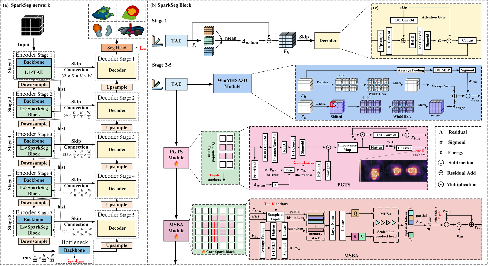
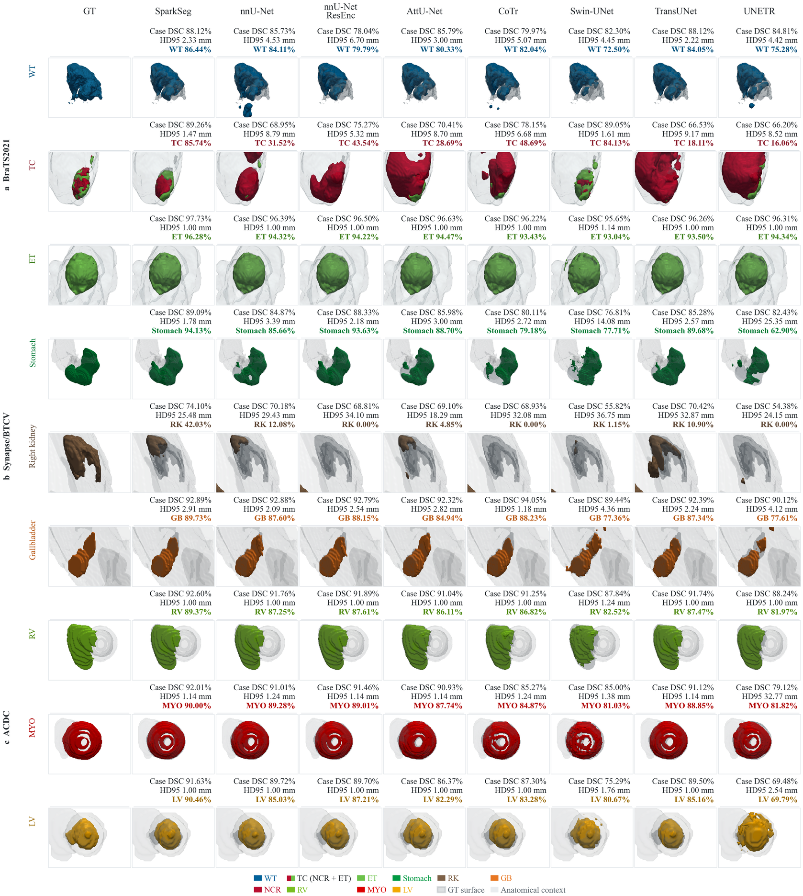
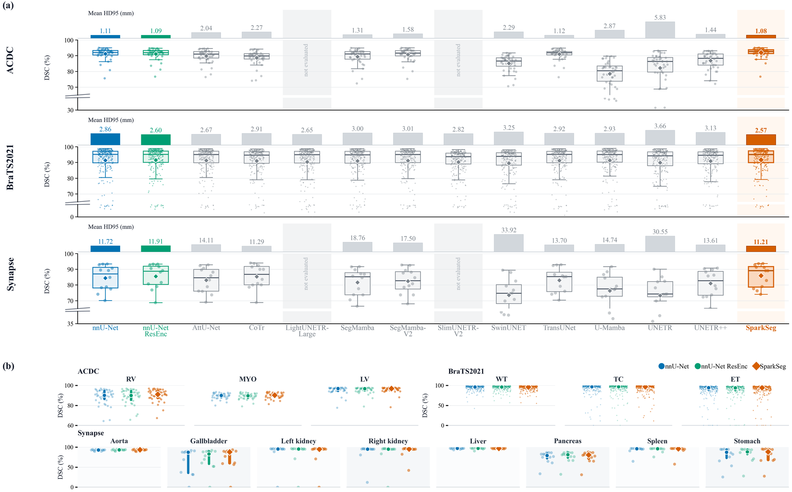
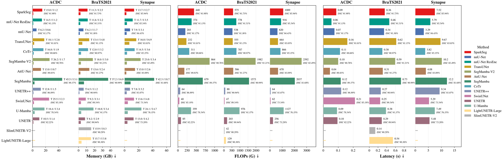
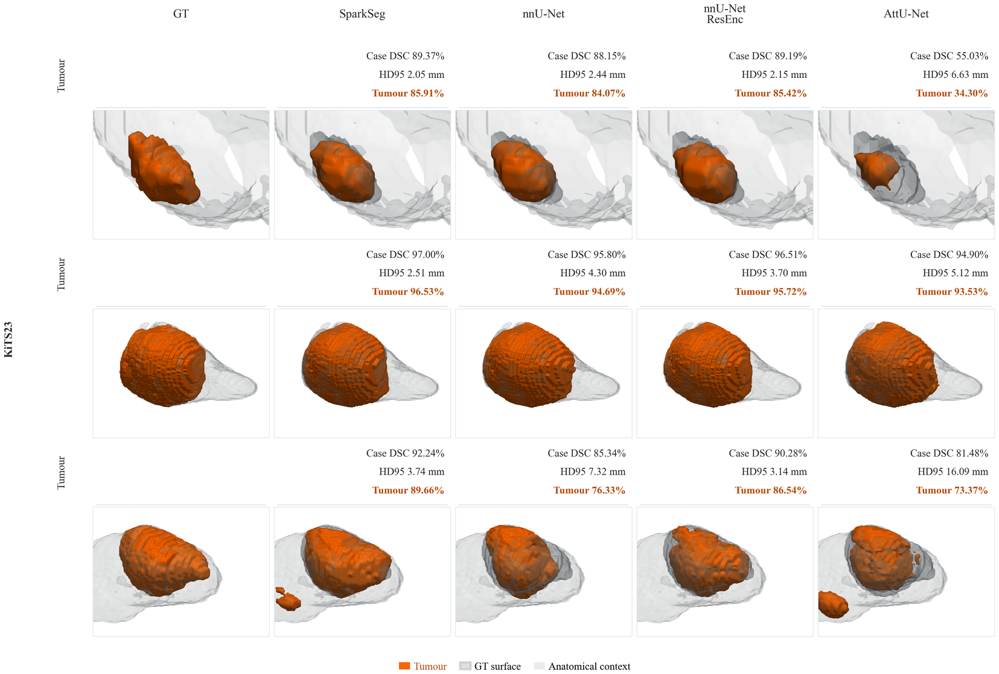
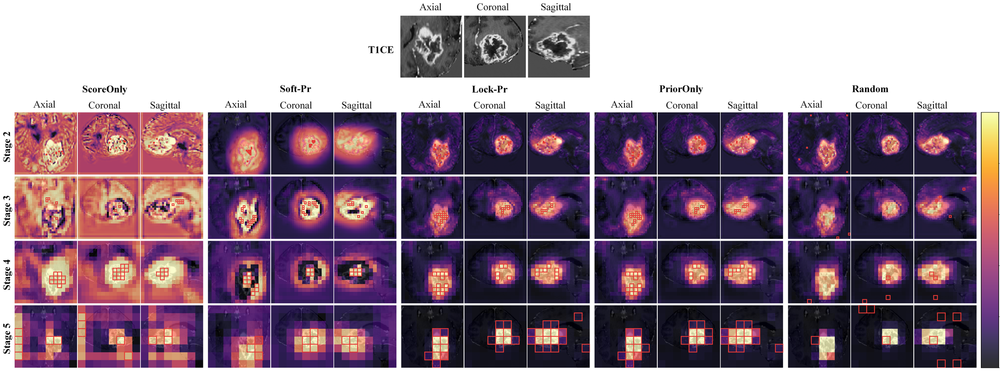
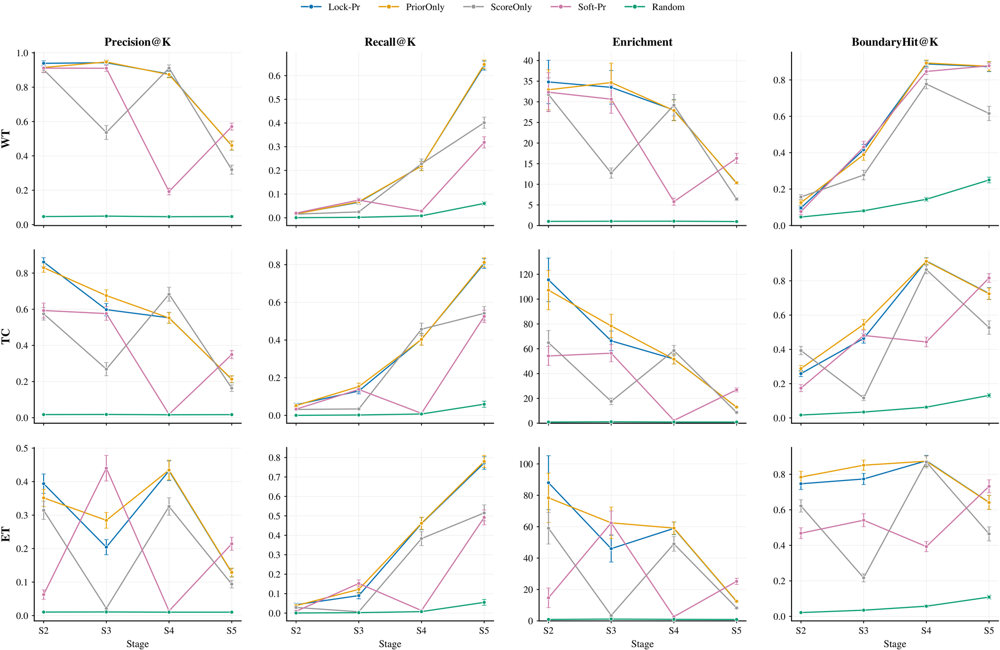

# ✨ SparkSeg

[English](README.md) | 中文

**SparkSeg：面向 3D CT / MRI 分割的稀疏先验引导锚点注意力网络**

SparkSeg 以稠密卷积 U-Net 为主干，把长程上下文变成固定 Top-K 锚点集上显式、可消融的读写操作：
任务条件先验决定“读哪里”，分阶段硬 Top-K 决定“读多少”，多源稀疏块注意力与门控残差写回只更新
被选中的位置。



## 💡 亮点

- **保留主干。** 在不替换 3D CNN 主干的前提下引入全局上下文。
- **任务感知锚点。** 锚点随图像解剖变化，同时保持任务相关性。
- **选择性写回。** 保留局部细节，同时传播全局证据。
- **可检查的路由。** 分阶段锚点图显示长程证据进入网络的位置。
- **领先结果。** 三个基准上最高 mean DSC、最低 HD95，并支持 KiTS23 迁移。

## 📊 论文结果

指标按 DSC (%) / HD95 (mm) 排列；DSC 越高越好，HD95 越低越好。SparkSeg 在四个数据集上均优于匹配的 nnU-Net 对照，结果使用粗体显示。

| 数据集          | SparkSeg DSC (%) ↑ / HD95 (mm) ↓ | nnU-Net DSC (%) ↑ / HD95 (mm) ↓ | nnU-Net ResEnc DSC (%) ↑ / HD95 (mm) ↓ |
| ------------ | -------------------------------: | ------------------------------: | -------------------------------------: |
| ACDC         | **91.98 / 1.08**                 | 91.17 / 1.11                    | 91.13 / 1.09                           |
| BraTS2021    | **91.73 / 2.57**                 | 91.36 / 2.86                    | 91.51 / 2.60                           |
| Synapse/BTCV | **85.94 / 11.21**                | 84.43 / 11.72                   | 85.54 / 11.91                          |
| KiTS23       | **85.66 / 13.41**                | 85.12 / 18.41                   | 84.36 / 17.78                          |

## 📋 论文全部方法对比

以下表格包括方法对比（表 1–4）。每一数值列的最优值以粗体标示，本文方法名称加粗。

### Table 1. BraTS2021 comparison

BraTS2021 留出测试集。(a) DSC (%) 与 HD95 (mm)；(b) 计算开销。

**(a) Segmentation**

| Model | DSC WT | DSC TC | DSC ET | DSC Avg | HD95 WT | HD95 TC | HD95 ET | HD95 Avg |
| :--- | ---: | ---: | ---: | ---: | ---: | ---: | ---: | ---: |
| nnU-Net [1] | 93.96 | 91.91 | 88.22 | 91.36 | 3.68 | 2.83 | 2.06 | 2.86 |
| nnU-Net ResEnc [22] | **94.05** | 91.92 | 88.57 | 91.51 | 3.33 | 2.54 | 1.93 | 2.60 |
| AttU-Net [9] | 94.02 | 91.59 | 88.20 | 91.27 | 3.29 | 2.54 | 2.17 | 2.67 |
| CoTr [24] | 93.78 | 91.13 | 87.99 | 90.97 | 3.59 | 2.97 | 2.17 | 2.91 |
| LightUNETR-Large [36] | 93.46 | 90.55 | 87.08 | 90.36 | **3.22** | 2.69 | 2.05 | 2.65 |
| SegMamba [16] | 94.04 | 91.35 | 87.57 | 90.99 | 3.73 | 3.08 | 2.20 | 3.00 |
| SegMamba-V2 [17] | 93.89 | 91.44 | 88.30 | 91.21 | 3.80 | 2.73 | 2.49 | 3.01 |
| SlimUNETR-V2 [37] | 92.93 | 91.74 | 86.20 | 90.29 | 3.49 | 2.54 | 2.43 | 2.82 |
| Swin-Unet [7] | 92.97 | 89.85 | 85.80 | 89.54 | 4.25 | 3.14 | 2.37 | 3.25 |
| TransUNet [4] | 93.58 | 91.36 | 88.50 | 91.15 | 3.94 | 2.82 | 1.99 | 2.92 |
| U-Mamba [13] | 93.78 | 91.74 | 88.58 | 91.37 | 3.78 | 2.78 | 2.22 | 2.93 |
| UNETR [5] | 92.97 | 90.18 | 86.67 | 89.94 | 4.18 | 3.85 | 2.96 | 3.66 |
| UNETR++ [38] | 93.54 | 91.69 | 87.59 | 90.94 | 3.93 | 3.06 | 2.40 | 3.13 |
| **SparkSeg** | 93.87 | **92.68** | **88.63** | **91.73** | 3.41 | **2.41** | **1.89** | **2.57** |

**(b) Compute**

| Model | Mem T/I (GB) | Params (M) | FLOPs (G) | Latency (s) |
| :--- | ---: | ---: | ---: | ---: |
| nnU-Net [1] | ~**6.2** / 1.7 | ~31.2 | ~538.1 | ~0.340 |
| nnU-Net ResEnc [22] | ~11.6 / 2.2 | ~102.4 | ~778.3 | ~0.460 |
| AttU-Net [9] | ~13.6 / 2.4 | ~23.6 | ~586.0 | ~0.311 |
| CoTr [24] | ~12.0 / 3.2 | ~41.9 | ~787.4 | ~0.301 |
| LightUNETR-Large [36] | ~15.7 / 3.8 | **~3.9** | ~129.4 | ~0.544 |
| SegMamba [16] | ~37.2 / 6.9 | ~67.4 | ~1573.0 | ~0.728 |
| SegMamba-V2 [17] | ~18.0 / 3.0 | ~139.2 | ~1982.5 | ~0.595 |
| SlimUNETR-V2 [37] | ~15.9 / **0.3** | ~23.6 | **~41.9** | **~0.138** |
| Swin-Unet [7] | ~9.2 / 3.1 | ~30.6 | ~46.8 | ~0.251 |
| TransUNet [4] | ~13.4 / 4.8 | ~119.0 | ~555.0 | ~0.620 |
| U-Mamba [13] | ~18.8 / 3.4 | ~42.2 | ~975.5 | ~0.384 |
| UNETR [5] | ~8.2 / 2.9 | ~130.8 | ~202.8 | ~0.288 |
| UNETR++ [38] | ~6.5 / 1.2 | ~23.5 | ~87.5 | ~0.265 |
| **SparkSeg** | ~11.3 / 2.5 | ~34.8 | ~575.1 | ~0.356 |

### Table 2. ACDC comparison

ACDC 留出测试集。(a) DSC (%) 与 HD95 (mm)；(b) 计算开销。

**(a) Segmentation**

| Model | DSC RV | DSC MYO | DSC LV | DSC Avg | HD95 RV | HD95 MYO | HD95 LV | HD95 Avg |
| :--- | ---: | ---: | ---: | ---: | ---: | ---: | ---: | ---: |
| nnU-Net [1] | 88.66 | 89.51 | 95.33 | 91.17 | 1.25 | **1.02** | 1.06 | 1.11 |
| nnU-Net ResEnc [22] | 88.70 | 89.27 | 95.41 | 91.13 | 1.22 | **1.02** | 1.03 | 1.09 |
| AttU-Net [9] | 86.60 | 88.15 | 94.72 | 89.83 | 4.04 | 1.04 | 1.04 | 2.04 |
| CoTr [24] | 85.24 | 86.68 | 94.07 | 88.66 | 4.64 | 1.09 | 1.09 | 2.27 |
| SegMamba [16] | 85.79 | 87.95 | 94.39 | 89.37 | 1.73 | 1.14 | 1.07 | 1.31 |
| SegMamba-V2 [17] | 87.94 | 89.10 | 95.22 | 90.76 | 2.58 | 1.13 | 1.04 | 1.58 |
| Swin-Unet [7] | 80.61 | 82.63 | 92.31 | 85.18 | 4.38 | 1.31 | 1.19 | 2.29 |
| TransUNet [4] | 88.73 | 89.07 | 95.24 | 91.01 | 1.29 | 1.03 | **1.02** | 1.12 |
| U-Mamba [13] | 71.23 | 75.30 | 89.09 | 78.54 | 4.64 | 2.07 | 1.89 | 2.87 |
| UNETR [5] | 74.98 | 80.84 | 90.84 | 82.22 | 14.31 | 1.62 | 1.55 | 5.83 |
| UNETR++ [38] | 82.23 | 85.39 | 93.06 | 86.89 | 1.90 | 1.29 | 1.14 | 1.44 |
| **SparkSeg** | **90.24** | **89.90** | **95.80** | **91.98** | **1.19** | **1.02** | **1.02** | **1.08** |

**(b) Compute**

| Model | Mem T/I (GB) | Params (M) | FLOPs (G) | Latency (s) |
| :--- | ---: | ---: | ---: | ---: |
| nnU-Net [1] | ~**6.2** / **0.6** | ~31.2 | ~203.4 | ~0.075 |
| nnU-Net ResEnc [22] | ~14.5 / 1.2 | ~102.4 | ~374.3 | ~0.055 |
| AttU-Net [9] | ~13.0 / 0.7 | ~23.6 | ~176.9 | **~0.045** |
| CoTr [24] | ~16.8 / 1.9 | ~41.9 | ~310.7 | ~0.112 |
| SegMamba [16] | ~45.5 / 3.1 | ~67.4 | ~678.8 | ~0.117 |
| SegMamba-V2 [17] | ~26.2 / 1.7 | ~139.2 | ~863.6 | ~0.100 |
| Swin-Unet [7] | ~25.5 / 2.3 | ~30.6 | **~40.4** | ~0.212 |
| TransUNet [4] | ~18.1 / 2.6 | ~119.0 | ~232.4 | ~0.161 |
| U-Mamba [13] | ~18.4 / 3.4 | ~42.2 | ~359.3 | ~0.092 |
| UNETR [5] | ~10.5 / 1.4 | ~130.8 | ~85.4 | ~0.095 |
| UNETR++ [38] | ~12.8 / 1.5 | **~23.5** | ~64.1 | ~0.120 |
| **SparkSeg** | ~15.0 / 1.2 | ~111.1 | ~440.4 | ~0.087 |

### Table 3a. Synapse/BTCV DSC

Synapse/BTCV：各器官 DSC (%)（12 例留出测试）。

| Model | Aor | Gal | LK | RK | Liv | Pan | Spl | Sto | Avg DSC |
| :--- | ---: | ---: | ---: | ---: | ---: | ---: | ---: | ---: | ---: |
| nnU-Net [1] | 92.70 | 66.09 | 87.07 | 87.17 | 96.54 | 74.30 | 92.86 | 78.70 | 84.43 |
| nnU-Net ResEnc [22] | 93.16 | 70.77 | 85.60 | 86.45 | 96.48 | 75.83 | 93.69 | **82.31** | 85.54 |
| AttU-Net [9] | 92.91 | 68.55 | 83.68 | 84.97 | 96.36 | 69.72 | 91.95 | 76.55 | 83.09 |
| CoTr [24] | **93.48** | 67.06 | 86.84 | 86.30 | 96.82 | **78.68** | 92.97 | 80.64 | 85.35 |
| SegMamba [16] | 91.03 | 61.18 | 85.43 | 86.99 | 95.83 | 68.26 | 91.47 | 73.24 | 81.68 |
| SegMamba-V2 [17] | 92.50 | 59.65 | **87.71** | 85.23 | 95.92 | 70.15 | **94.83** | 73.90 | 82.49 |
| Swin-Unet [7] | 83.30 | 54.93 | 79.20 | 74.86 | 92.85 | 49.66 | 85.29 | 68.21 | 73.54 |
| TransUNet [4] | 93.18 | 64.04 | 85.65 | 87.03 | 96.57 | 70.69 | 91.25 | 75.81 | 83.03 |
| U-Mamba [13] | 91.64 | 58.98 | 80.94 | 77.30 | 96.03 | 60.08 | 87.66 | 58.20 | 76.35 |
| UNETR [5] | 84.49 | 63.26 | 78.44 | 78.01 | 93.79 | 51.34 | 80.49 | 56.40 | 73.28 |
| UNETR++ [38] | 91.78 | 58.16 | 86.61 | 85.45 | 95.84 | 64.81 | 91.19 | 74.73 | 81.07 |
| **SparkSeg** | 93.25 | **73.66** | 85.54 | **89.93** | **96.97** | 75.20 | 92.49 | 80.45 | **85.94** |

缩写：Aor 主动脉；Gal 胆囊；LK/RK 左/右肾；Liv 肝；Pan 胰腺；Spl 脾；Sto 胃。

### Table 3b. Synapse/BTCV HD95

Synapse/BTCV：各器官 HD95 (mm)。

| Model | Aor | Gal | LK | RK | Liv | Pan | Spl | Sto | Avg HD95 |
| :--- | ---: | ---: | ---: | ---: | ---: | ---: | ---: | ---: | ---: |
| nnU-Net [1] | 3.12 | 25.26 | 17.50 | 7.26 | 4.29 | 10.02 | 8.14 | 20.04 | 11.72 |
| nnU-Net ResEnc [22] | **1.48** | 14.60 | 18.34 | 8.94 | 7.41 | 7.09 | 21.13 | **17.34** | 11.91 |
| AttU-Net [9] | 4.83 | 23.22 | 7.91 | 24.00 | 3.19 | 10.44 | 8.13 | 32.88 | 14.11 |
| CoTr [24] | 1.49 | 18.45 | 15.91 | 10.15 | 2.16 | **6.40** | 6.95 | 31.51 | 11.29 |
| SegMamba [16] | 8.74 | 31.36 | 17.85 | 6.16 | 15.80 | 9.56 | 29.31 | 33.66 | 18.76 |
| SegMamba-V2 [17] | 8.09 | 22.52 | 15.29 | 22.53 | 18.16 | 16.04 | **6.60** | 32.42 | 17.50 |
| Swin-Unet [7] | 34.78 | 23.13 | 53.22 | 28.03 | 17.86 | 16.43 | 62.78 | 36.69 | 33.92 |
| TransUNet [4] | 1.87 | 25.85 | 18.73 | 8.88 | **1.76** | 11.04 | 13.30 | 30.17 | 13.70 |
| U-Mamba [13] | 11.34 | 23.03 | **4.96** | 10.81 | 4.76 | 28.66 | 11.50 | 24.55 | 14.74 |
| UNETR [5] | 10.91 | 18.71 | 26.95 | 46.51 | 42.48 | 23.24 | 38.98 | 37.76 | 30.55 |
| UNETR++ [38] | 2.43 | 18.04 | 17.31 | 24.51 | 3.50 | 11.42 | 8.97 | 23.78 | 13.61 |
| **SparkSeg** | 1.67 | **13.23** | 18.60 | **3.87** | 2.12 | 9.66 | 21.57 | 19.86 | **11.21** |

### Table 3c. Synapse/BTCV resources

Synapse/BTCV：训练/推理峰值显存、参数量、FLOPs 与延迟。

| Model | Mem T/I (GB) | Params (M) | FLOPs (G) | Latency (s) |
| :--- | ---: | ---: | ---: | ---: |
| nnU-Net [1] | ~7.9 / 3.1 | ~31.2 | ~619.6 | **~3.290** |
| nnU-Net ResEnc [22] | ~11.7 / 3.5 | ~102.4 | ~916.2 | ~5.785 |
| AttU-Net [9] | ~15.0 / **2.6** | ~23.6 | ~670.4 | ~4.079 |
| CoTr [24] | ~14.5 / 3.6 | ~41.9 | ~865.6 | ~3.818 |
| SegMamba [16] | ~42.3 / 8.7 | ~67.4 | ~2037.2 | ~12.166 |
| SegMamba-V2 [17] | ~23.0 / 3.4 | ~139.2 | ~2591.6 | ~10.181 |
| Swin-Unet [7] | ~13.6 / 4.8 | ~30.6 | **~62.0** | ~5.292 |
| TransUNet [4] | ~16.8 / 6.9 | ~119.0 | ~663.8 | ~9.667 |
| U-Mamba [13] | ~24.1 / 4.7 | ~42.2 | ~1126.8 | ~7.493 |
| UNETR [5] | ~13.0 / 4.2 | ~130.8 | ~256.4 | ~5.476 |
| UNETR++ [38] | ~**7.8** / 3.2 | **~23.5** | ~64.5 | ~9.335 |
| **SparkSeg** | ~13.7 / 2.7 | ~111.1 | ~1089.4 | ~7.523 |

### Table 4. KiTS23 comparison

KiTS23：98 例留出测试上的 DSC (%) 与 HD95 (mm)。

| Model | DSC K&M | DSC KM | DSC T | DSC Avg | HD95 K&M | HD95 KM | HD95 T | HD95 Avg |
| :--- | ---: | ---: | ---: | ---: | ---: | ---: | ---: | ---: |
| nnU-Net | 95.89 | 81.56 | 77.92 | 85.12 | 11.02 | 20.49 | 23.73 | 18.41 |
| nnU-Net ResEnc | 95.69 | 81.32 | 76.06 | 84.36 | 8.60 | 19.69 | 25.06 | 17.78 |
| AttU-Net | 94.47 | 77.76 | 72.35 | 81.53 | 13.13 | 26.90 | 31.83 | 23.95 |
| **SparkSeg** | **96.16** | **82.83** | **78.00** | **85.66** | **5.86** | **15.18** | **19.19** | **13.41** |

## 🧠 可用训练器

| 模态 | 数据集 | ID | Trainer | 主干 | 初始化 | Epochs |
|---|---|---:|---|---|---|---:|
| MRI | ACDC | 100 | `nnUNetTrainerSparkSegACDC` | residual encoder | 不使用 `stock_he` | 200 |
| MRI | BraTS2021 | 1251 | `nnUNetTrainerSparkSegBraTS2021` | plain U-Net | 不使用 `stock_he` | 1,000 |
| CT | Synapse/BTCV | 180 | `nnUNetTrainerSparkSegSynapse` | residual encoder | `stock_he` | 1,000 |
| CT | KiTS23 | 489 | `nnUNetTrainerSparkSegKiTS23` | residual encoder | `stock_he` | 1,000 |

正式训练器位于
[nnUNetTrainerSparkSeg.py](nnunetv2/training/nnUNetTrainer/nnUNetTrainerSparkSeg.py)，
评估实现位于 [nnUNetTrainerSparkSeg_eval.py](nnUNetTrainerSparkSeg_eval.py)。
模型、配置、工具代码、论文插图和固定划分均位于
[nnunetv2/training/network/source_code/SparkSeg](nnunetv2/training/network/source_code/SparkSeg/)。

| 数据集 | Patch | Batch | 训练显存 | Params | FLOPs | Latency |
|---|---|---:|---:|---:|---:|---:|
| ACDC | 224×256×10 | 7 | 15.0 GB | 111.1 M | 440.4 G | 0.087 s |
| BraTS2021 | 128×128×128 | 2 | 11.3 GB | 34.8 M | 575.1 G | 0.356 s |
| Synapse/BTCV | 56×192×224 | 2 | 13.7 GB | 111.1 M | 1,089.4 G | 7.523 s |
| KiTS23 | 128×128×128 | 2 | — | — | — | — |

## ⚙️ WSL 安装

训练、推理和评估在 WSL 中执行。三个目录由使用者自行设置，脚本只读取官方
nnU-Net 环境变量：

```text
nnUNet_raw           原始数据目录
nnUNet_preprocessed  预处理数据目录
nnUNet_results       训练结果和权重目录
```

```bash
cd /path/to/SparkSeg
python -m pip install -e .

export NNUNET_DATA_ROOT=/path/to/nnUNet_data
export nnUNet_raw="$NNUNET_DATA_ROOT/nnUNet_raw"
export nnUNet_preprocessed="$NNUNET_DATA_ROOT/nnUNet_preprocessed"
export nnUNet_results="$NNUNET_DATA_ROOT/nnUNet_results"

python -m SparkSeg.reproduce doctor --datasets acdc brats synapse kits23
```

请从当前源码目录运行，以使用本项目内置的 SparkSeg 版 `nnunetv2/`。训练和
推理时，复现 CLI 会临时创建 Trainer 注册文件，不依赖仓库外的评估脚本或桥接
文件。

## 🚀 训练

训练目标为 `L_seg + 0.05 L_prior + 0.02 L_prioraux`，优化器为 SGD，初始
学习率 `1e-2`、Nesterov 动量 `0.99`、权重衰减 `3e-5`、多项式衰减，每个
epoch 执行 `250/50` 次训练/验证迭代。

KiTS23 尚未预处理时先执行：

```bash
python -m SparkSeg.reproduce prepare --datasets kits23
```

其他新数据同理：

```bash
python -m SparkSeg.reproduce prepare --datasets acdc brats synapse kits23
```

逐个训练：

```bash
python -m SparkSeg.reproduce train --datasets acdc
python -m SparkSeg.reproduce train --datasets brats
python -m SparkSeg.reproduce train --datasets synapse
python -m SparkSeg.reproduce train --datasets kits23
```

多卡训练：

```bash
python -m SparkSeg.reproduce train --datasets brats --num-gpus 2
```

训练后的 checkpoint 位于：

```text
$nnUNet_results/<Dataset>/<Trainer>__nnUNetPlans__3d_fullres/fold_<fold>/checkpoint_final.pth
```

## 🔎 推理与评估

```bash
python -m SparkSeg.reproduce predict --datasets acdc
python -m SparkSeg.reproduce predict --datasets brats
python -m SparkSeg.reproduce predict --datasets synapse
python -m SparkSeg.reproduce predict --datasets kits23

python -m SparkSeg.reproduce evaluate --datasets acdc
python -m SparkSeg.reproduce evaluate --datasets brats
python -m SparkSeg.reproduce evaluate --datasets synapse
python -m SparkSeg.reproduce evaluate --datasets kits23
```

`validate` 是 `evaluate` 的等价命令。预测和指标默认写入：

```text
$nnUNet_raw/<Dataset>/labelsTs_SparkSeg/final_pre
```

推理遵循论文设置，不使用测试时增强（TTA）。

| 数据集 | 指标文件 |
|---|---|
| ACDC | `metrics_ACDC_testset.json/.csv` |
| BraTS2021 | `metrics_BraTS_WT_TC_ET_testset.json/.csv` |
| Synapse/BTCV | `metrics_synapse_testset.json/.csv` |
| KiTS23 | `metrics_KiTS23_HEC_testset.json/.csv` |

## 📦 Release 权重

使用 Release 权重：

```bash
python -m SparkSeg.reproduce download --out ./SparkSeg_releases --tag v1.3.0

python -m SparkSeg.reproduce install \
  ./SparkSeg_releases/sparkseg-acdc-mri-3d_fullres.zip \
  ./SparkSeg_releases/sparkseg-brats2021-mri-3d_fullres.zip \
  ./SparkSeg_releases/sparkseg-synapse-ct-3d_fullres.zip \
  ./SparkSeg_releases/sparkseg-kits23-ct-3d_fullres.zip

python -m SparkSeg.reproduce verify --load-checkpoints
```

每个权重包包含 `manifest.json`、`plans.json`、`dataset.json` 和
`fold_<fold>/checkpoint_final.pth`；存在固定划分时还包含 `splits_final.json`。

## 🐍 Python API

```python
from SparkSeg import build_sparkseg, describe_preset

strides = [[1, 1, 1], [2, 2, 2], [2, 2, 2], [2, 2, 2], [2, 2, 2], [2, 2, 2]]
net = build_sparkseg(4, 4, plan_strides=strides, preset="brats")
print(describe_preset("brats"))
```

预设名称包括 `acdc`、`brats`/`brats2021`、`synapse`/`btcv` 和
`kits23`/`kits`；也可使用数据集 ID 或 nnU-Net 文件夹名。

## 🗂️ 数据与划分

每个预设的固定划分文件均位于 [splits](nnunetv2/training/network/source_code/SparkSeg/splits/)。ACDC、BraTS2021 和
KiTS23 使用 fold 0。Synapse 使用 fold `all`：其划分文件记录 `imagesTr` 中的
18 个病例，nnU-Net 将它们同时用于训练和验证；`imagesTs` 中的 12 个病例仍
作为独立的 held-out 测试集。

| 数据集 | 模态 | 病例数 | 训练 / 验证 / held-out 测试 | 来源 |
|---|---|---:|---|---|
| ACDC | MRI | 100 例患者 | 70 / 10 / 20 例患者（140 / 20 / 40 个 volume） | [Human Heart Project](https://humanheart-project.creatis.insa-lyon.fr/database/#collection/637218c173e9f0047faa00fb) |
| BraTS2021 | MRI | 1,251 | 875 / 125 / 251 | [Synapse syn25829067](https://www.synapse.org/Synapse:syn25829067) |
| Synapse/BTCV | CT | 30 | 18 例训练；12 例 held-out 测试 | [Synapse syn3193805](https://www.synapse.org/Synapse:syn3193805/wiki/89480) |
| KiTS23 | CT | 489 | 342 / 49 / 98 | [KiTS23 challenge](https://kits-challenge.org/kits23/) |

预处理、plans、拓扑与增强遵循标准 `3d_fullres` 协议。KiTS23 使用
CC BY-NC-SA 4.0。

## 🖼️ 图片

<p align="center">
  <a href="nnunetv2/training/network/source_code/SparkSeg/assets/paper/fig01_overview.png"></a>
</p>

<table>
  <tr>
    <td align="center" width="50%"><a href="nnunetv2/training/network/source_code/SparkSeg/assets/paper/fig02_qualitative.png"></a><br><strong>图 2</strong>：ACDC、BraTS2021 与 Synapse/BTCV 定性对比</td>
    <td align="center" width="50%"><a href="nnunetv2/training/network/source_code/SparkSeg/assets/paper/fig03_per_case_dsc.png"></a><br><strong>图 3</strong>：逐例 DSC 分布与 mean HD95</td>
  </tr>
  <tr>
    <td align="center" width="50%"><a href="nnunetv2/training/network/source_code/SparkSeg/assets/paper/fig04_resource_profiles.png"></a><br><strong>图 4</strong>：显存、FLOPs 与延迟概况</td>
    <td align="center" width="50%"><a href="nnunetv2/training/network/source_code/SparkSeg/assets/paper/fig05_kits23.png"></a><br><strong>图 5</strong>：KiTS23 肿瘤对比</td>
  </tr>
  <tr>
    <td align="center" width="50%"><a href="nnunetv2/training/network/source_code/SparkSeg/assets/paper/fig06_anchor_visualisation.png"></a><br><strong>图 6</strong>：Stages 2–5 先验引导 Top-K 锚点</td>
    <td align="center" width="50%"><a href="nnunetv2/training/network/source_code/SparkSeg/assets/paper/fig07_selection_quality.png"></a><br><strong>图 7</strong>：锚点选择质量（Precision@K、Recall@K、Enrichment、BoundaryHit@K）</td>
  </tr>
</table>

## 📄 引用与许可

```bibtex
@misc{chai2026sparkseg,
  author  = {Chai, Shuaishuai and Jin, Liang and Li, Ming},
  title   = {SparkSeg: sparse prior-guided anchor attention for 3D CT and MRI segmentation},
  year    = {2026},
  url     = {https://github.com/sshuaichai/SparkSeg}
}
```

[Apache-2.0](LICENSE.txt)。训练与推理基于
[nnU-Net](https://github.com/MIC-DKFZ/nnUNet)。
